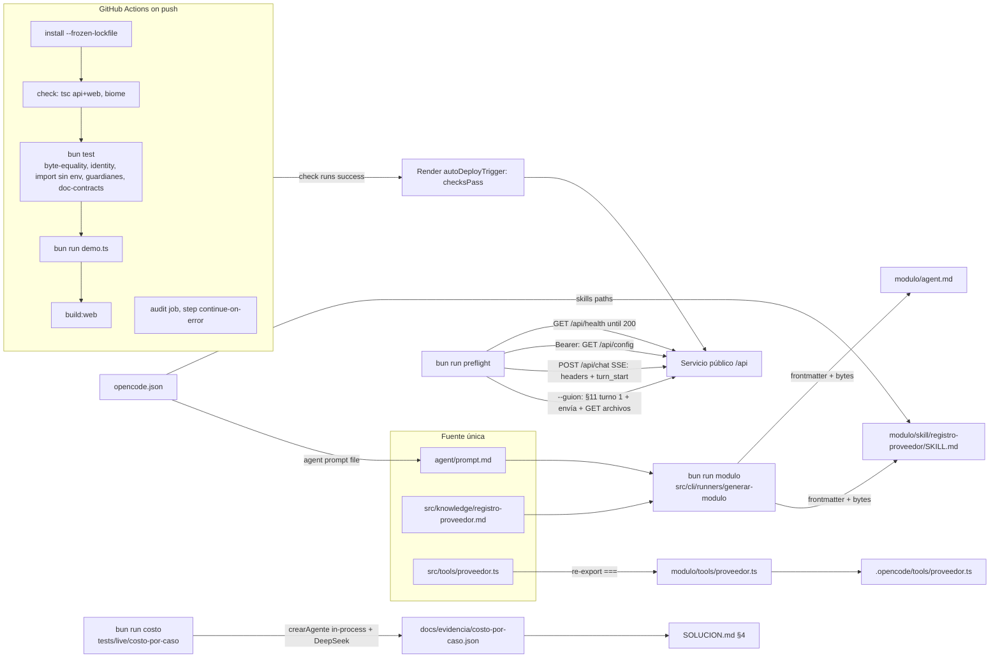

# Phase 4: Módulo, documentación y defensa - Research

**Researched:** 2026-10-15
**Domain:** Packaging (OpenCode-style module from a single source), CI (GitHub Actions + Bun), Render Blueprint deploy gating, live cost measurement (DeepSeek usage), pre-flight HTTP/SSE probe, delivery docs
**Confidence:** HIGH for in-repo facts and CI behavior (exec-verified, including a Linux container run); MEDIUM for OpenCode, Render and GitHub (official docs fetched this session); LOW where marked `[ASSUMED]`

<user_constraints>
## User Constraints (from CONTEXT.md)

### Locked Decisions

### modulo/ como fuente única (MOD-01, MOD-02)
- **D-79:** El cuerpo de `modulo/agent.md` es **idéntico byte a byte** a `agent/prompt.md`, sin párrafos agregados. Solo se le antepone el frontmatter del PRD §9.4: `description`, `mode: primary` y `permission { edit: deny, bash: deny }`. Del mismo modo, el cuerpo de `modulo/skill/registro-proveedor/SKILL.md` es idéntico a `src/knowledge/registro-proveedor.md`, con frontmatter `name` y `description`. Motivo: el §9.4 evalúa que las piezas sean "las mismas que usa tu aplicación (no copias divergentes)", y cualquier añadido se leería como divergencia.
- **D-80:** Fuera del servidor (OpenCode) nadie formula la pregunta de confirmación al cierre del turno, porque desde 02-18 la escribe el servidor y `prompt.md` ya no la pide. Se **acepta y se documenta** en `SOLUCION.md` (riesgos o supuestos) y en un `modulo/README.md` corto. La red de seguridad sigue en pie: el conocimiento dice que `proveedor_simular_envio` solo se usa tras una confirmación explícita, y la herramienta exige `confirmado: true`. Resuelve el bloqueante de STATE.md "[Phase 4] modulo/agent.md… quién pide la confirmación".
- **D-81:** `modulo/tools/proveedor.ts` **re-exporta** las herramientas de `src/tools/proveedor.ts` con el alias `@/`, sin copias ni bundle. El módulo funciona cuando el host (OpenCode u otro) se abre en la raíz del repo: las herramientas ya resuelven fixtures y `out/` desde `ctx.directory` y aceptan `sessionID`. El test de **identidad de referencia** comprueba que cada export de `modulo/` es `===` al de la app. No hay `bun build` a `dist/`.
- **D-82:** `agent.md` y `SKILL.md` se **generan con un script y se commitean**, para que el evaluador vea `modulo/` completo sin correr nada. Un test de **igualdad byte a byte** compara los archivos commiteados con la salida del generador, así que si alguien edita `prompt.md` o el conocimiento sin regenerar, la CI falla. También hay un test de **importación sin env** de `modulo/tools/proveedor.ts`. Los textos del frontmatter (`description`) salen de `src/config/strings.ts` o de constantes, según las reglas del repo.
- **D-83:** Se agrega un **`opencode.json` en la raíz** que registra el agente, las herramientas y la skill desde `modulo/`, como evidencia tangible de la integración. **No** se instala OpenCode ni se ensaya en vivo, porque el PRD no lo exige. El investigador verifica el formato vigente de OpenCode: frontmatter del agente, forma `{ description, args, execute }` de la herramienta, nombre `<archivo>_<export>`, frontmatter de la skill, campo `sessionID` del contexto y esquema de `opencode.json`.

### SOLUCION.md (DOC-02)
- **D-84:** Es **conciso y enlaza**: cada sección cabe en una pantalla y el detalle vive en `docs/` (límites del demo, arquitectura, convenciones). Tiene que poder leerse en unos 10 minutos antes de la defensa. Está en español y respeta las 10 secciones en el orden del §9.1.
- **D-85:** El diagrama de arquitectura (§2) va en **Mermaid**: front → backend (bucle, adaptador LLM, compuerta) → herramientas → `fixtures/` y `out/`, y dónde viven el prompt, el conocimiento y la ejecución.
- **D-86:** El costo por caso (§4) sale de una **corrida medida nueva**. Un script corre en vivo contra DeepSeek los 4 casos y el guion §11 una vez, toma `prompt_cache_hit_tokens`, `prompt_cache_miss_tokens` y `completion_tokens` del `usage` registrado, y arma la tabla con los precios vigentes de `deepseek-flash`. La corrida es reproducible y su evidencia queda en el repo, sin PII ni claves. Se puede reutilizar la infraestructura de `test:vivo` (`tests/live`).
- **D-87:** "Uso de IA" (§9): **Claude Code con el flujo GSD**. La sección destaca los **agentes y wrappers propios**: `eli-qa-sdd-gsd` (un runner de QA que envuelve `verify-work` con suites reproducibles, recetas CLI, HTTP, SSE y navegador con Playwright, escaneo de PII y determinismo) y `eli-qa-map-repos` (el manifiesto de topología). Explica **cómo se adaptó el flujo hacia la calidad**: guardianes de arquitectura G1–G16 y W1–W13, el test sin comentarios, code review, auditoría de seguridad (87/87), UAT con evidencia y cierres de brechas. Lo descartado se redacta desde `.planning/`: LangChain y el AI SDK, el SDK `openai`, SheetJS, Tailwind y `react-markdown`, la gramática de rechazo por texto (D-63.11) y el ciclo de parches del limitador. La usuaria revisa el texto final.
- **D-88:** `SOLUCION.md` recoge lo que STATE.md y las fases anteriores dejaron pendiente:
  - los límites del demo (pendiente incorporado; ver Folded Todos);
  - AR-02-06 y D-63.11;
  - WR-03 y los ids canónicos de la demo;
  - la nota de NOMBRE_SOPORTE (IN-01), que se mueve desde `docs/plantillas.md`;
  - el estado de SEG-02;
  - T-02-41;
  - la cookie HttpOnly firmada, elegida por buenas prácticas;
  - D-09 (para qué sirve el LLM si el núcleo es determinista) como trade-off;
  - `demo.ts` como verificación sin modelo (D-70);
  - los seguimientos menores de la QA de la Fase 3;
  - la rúbrica ausente del §10 como supuesto en §7, junto con la fecha de ejecución y el envío con bloqueos;
  - la justificación de cada dependencia (PRD §8);
  - D-80 como límite del módulo.

### CI, badge y repo (DEMO-05)
- **D-89:** La entrega es el **repo privado con los evaluadores invitados** como colaboradores. Así ven el badge y el README con el código de acceso, y el código no queda público.
- **D-90:** La CI de GitHub Actions corre `bun run check` (tsc del backend y de la web, más Biome), `bun test` (incluidos los guardianes), `bun run demo.ts` y `build:web`, con `bun install --frozen-lockfile` y la versión de Bun de `.bun-version`. **`bun audit` va en un job aparte que no bloquea el badge**, para que un aviso nuevo de terceros la víspera de la defensa no lo pinte de rojo. El job principal no debe incluir el audit, aunque hoy `bun run check` sí lo incluye: el planner decide cómo separarlo (por ejemplo, un script `check` sin audit más `audit` aparte). El badge va arriba en el README.
- **D-91:** **Render despliega solo si pasa la CI**: `render.yaml` cambia `autoDeploy: true` por el disparador por checks (`autoDeployTrigger: checksPass`, a verificar por el investigador). Hay que actualizar `tests/despliegue/contrato-despliegue.test.ts` si aserta sobre `autoDeploy`. — **Reversibility:** reversible — es un campo del blueprint.

### Pre-flight y defensa (DEP-03)
- **D-92:** El pre-flight es un script de Bun contra el link público:
  - **Por defecto**, sin gastar tokens: despierta el servicio, espera `/api/health`, comprueba el código de acceso y el handshake SSE (ping o encabezados sin buffering).
  - **Con `--guion`**: corre el §11 completo en dos turnos. Primero "Procesa el caso ec-corp-andina… No envíes nada todavía" y verifica `needsConfirmation` y los bloqueos. Después "envía" y verifica que exista `ENVIO-SIMULADO.md`. Reporta los tokens usados.
  - El código de acceso y la URL se leen de env o de argumentos, nunca hardcodeados.
- **D-93:** Para mantener despierto Render basta lo simple: correr el pre-flight unos 10 minutos antes de la defensa, porque la propia defensa genera tráfico. **No** se configura un cron externo; el README solo lo menciona como opción.
- **D-94:** El **código de acceso va literal en el README**, como pide el §9.2. Solo lo ven los invitados (D-89) y se rota después de la evaluación (es la env var `ACCESS_CODE` de Render, `sync: false`). El README advierte que el valor tiene que coincidir con el de Render.
- **D-95:** El ensayo del §11 sobre el link público (criterio 5) lo hace **eli-qa con Playwright**: una prueba de la suite de la Fase 4 en el navegador sobre Render, con capturas como evidencia. **Después la usuaria lo ensaya una vez a mano**, como en la defensa.

### Folded Todos
- **Llevar a SOLUCION.md los límites del demo (estado en memoria y disco efímero)** (`.planning/todos/pending/2026-10-15-solucion-limites-del-demo.md`). La sección de riesgos (§10) de SOLUCION.md explica tres cosas, basadas en `docs/limites-del-demo.md`: qué se pierde al reiniciar o redesplegar, o cuando Render duerme el servicio (tope diario, limitadores por IP, cupos de turno, sesiones nuevas, sesiones y `out/`); por qué se acepta en el reto; y qué haría un despliegue real (Redis o una base de datos, alertas de gasto, una instancia siempre activa o varias con estado compartido, almacenamiento de objetos para `out/`). Al cerrar la fase se marca como resuelto.

### Claude's Discretion
- La estructura y el orden del `README.md`: badge, link y código, un comando, env vars desde `.env.example`, `demo.ts`, tests, pre-flight y `modulo/`.
- Si `docs/arquitectura.md` absorbe, resume o enlaza `docs/estructura.md`, y cómo `docs/convenciones.md` se deriva de las reglas de `.claude/CLAUDE.md` sin duplicarlas a mano.
- Qué trade-offs entran en §6 (mínimo 3, cada uno con la alternativa descartada). Candidatos: el LLM solo orquesta (D-09); un bucle propio en vez de un framework; la compuerta decidida por el servidor en vez del modelo; la minimización de PII hacia el LLM; SSE en vez de WebSockets; Render free con Dockerfile como plan B; la cookie HttpOnly.
- Dónde viven el script generador de `modulo/`, el de costo y el de pre-flight, y cómo se nombran sus comandos en `package.json`, siempre que respeten los guardianes de layout (G13 y similares). Si una regla nueva lo exige, se actualizan en la misma tarea `.claude/CLAUDE.md` y los guardianes (precedente D-62).
- La redacción exacta del frontmatter `description` de `agent.md` y `SKILL.md`.

### Deferred Ideas (OUT OF SCOPE)
- **Procesar sin el modelo** (G-03-15 opción A, viene de la Fase 3): sigue diferido. Si se quisiera antes de la defensa, sería una fase 3.1 aparte, porque revierte D-70.
- **Bundle portable de `modulo/`** con `bun build` a `dist/`, para usarlo fuera de este repo: descartado por ahora (D-81). Queda como trabajo futuro en SOLUCION.md.
- **Ensayo en vivo con OpenCode**: no se hace (D-83). Solo se agrega `opencode.json` y se verifica el formato.
- **Cron externo para calentar Render** (cron-job.org o UptimeRobot): solo se documenta como opción (D-93).
- Siguen diferidos desde las fases 2 y 3: revelar el valor real en la UI por un canal aparte del modelo, y cambiar de proveedor o de modelo desde la UI.
</user_constraints>

<phase_requirements>
## Phase Requirements

| ID | Description | Research Support |
|----|-------------|------------------|
| MOD-01 | `modulo/` contiene `agent.md` (frontmatter `description`, `mode: primary`, `permission {edit: deny, bash: deny}` y como cuerpo el prompt), `tools/proveedor.ts` y `skill/registro-proveedor/SKILL.md` (frontmatter `name` y `description`, y como cuerpo el conocimiento). | OpenCode frontmatter verified against official docs (Pattern 1, 2); YAML frontmatter shape exec-verified with `Bun.YAML`; skill `name` must match directory `registro-proveedor` (OpenCode rule). |
| MOD-02 | `modulo/` es fuente única. Un script genera `agent.md` y `SKILL.md` desde `agent/prompt.md` y `src/knowledge/`, y `tools/proveedor.ts` re-exporta las herramientas de la app. Hay tests de igualdad byte a byte, de identidad de referencia y de importación sin env. | Generator location + guardian edits (Pattern 3); identity across `modulo/` → `@/` re-export exec-verified in a spike; import-without-env pattern already exists in `tests/e2e/trazador.test.ts:253-264`. |
| DOC-01 | README: un comando, env vars, `demo.ts`, link y código de acceso. | README contract (Pattern 8); `ACCESS_CODE` is required to start `dev:api` (topology probe); Render URL verified live. |
| DOC-02 | SOLUCION.md con 10 secciones. | Section checklist + doc-contract test (Pattern 8); cost evidence design (Pattern 6); DeepSeek prices cited. |
| DEP-03 | Pre-flight calienta, verifica health y SSE; §11 ensayado sobre el link público. | Exact HTTP contract read from `src/http/**` (Pattern 5); eli-qa Phase 4 suite reusing T18–T21 recipes (Pattern 9). |
| DEMO-05 | GitHub Actions corre `bun test`, `bun run demo.ts`, `tsc --noEmit` y lint; README con badge. | CI simulated in a clean clone (macOS) and in a Linux container; root-user pitfall found (Pitfall 1); action versions/SHAs verified (Pattern 4). |
| CAL-05 | `docs/arquitectura.md` y `docs/convenciones.md`; Conventional Commits con identidad `elianatorres5772`. | History audited: 760/760 commits conventional with the right identity; `docs/estructura.md` must keep its name (guardian IN-21). |
</phase_requirements>

## Project Constraints (from CLAUDE.md)

Directives in `.claude/CLAUDE.md` that this phase must honor (same authority as locked decisions):

- No comments in code (`src/`, `tests/`, `demo.ts`, `web/`); explanations go to `docs/`, README, SOLUCION. `description`/`.describe()` are contract, not comments.
- Strict TS without `any`; `bun run check` (tsc + Biome) must pass.
- Constants/config centralized, typed, zod-validated; no magic values. Constants in `src/config/constants/<ámbito>.constants.ts`; regex only in `patterns.constants.ts`; all human/model text in `src/config/strings.ts`.
- Dependencies point inward; three composition roots only (`tools/wiring/entorno.wiring.ts`, `loop/wiring/agente.wiring.ts`, `http/wiring/server.wiring.ts`). `config/env.ts` is the only reader of `process.env` and only listed layers may import it.
- Exported types only in `types/*.type.ts`; codes are `as const` objects (never `enum`); `z.enum` built from the constant (G15); exported `…Schema` uses `satisfies z.ZodType<T>` (G16).
- Kebab-case files with role suffix per folder; no loose `.ts` in `src/` or a layer root except the four fixed names. PRD-fixed names do not change: `demo.ts`, `src/tools/proveedor.ts`, `src/knowledge/**`.
- Imports only via `@/`, `@tests/`, `@web/`; never `../` or `./`.
- Every shape rule has a guardian with a violation test (`tests/architecture.test.ts` G1–G16, `tests/arquitectura-web.test.ts` W1–W13, `tests/sin-comentarios.test.ts`). New rules update CLAUDE.md + guardian + `docs/estructura.md` in the same task (D-62).
- Never modify `reto-01/`. Commits: Conventional Commits, identity `elianatorres5772 <elianatorres5772@gmail.com>`.
- Docs in Spanish. Domain/application/tools identifiers in Spanish; infra and `config/env.ts` in English.
- Security: key only in backend env; never in repo, front, logs, API responses. Tools never run shell. No real data.
- Supply chain: 7-day maturity policy for any new version (D-35); applies to CI actions (pin by version or SHA).

## Summary

This phase adds no agent/API/SPA behavior; it packages, documents, gates and rehearses. All four automated legs of the CI are already green on a fresh clone with an empty environment: I cloned HEAD into a scratch dir, ran `bun install --frozen-lockfile`, `bun test` (2325 pass, 1 skip, 0 fail), `bun run demo.ts` (exit 0, 4-case table), `tsc` (api + web) + `biome check .` (exit 0), `build:web` (OK) and `bun audit` (no vulnerabilities) `[VERIFIED: local exec 2026-10-15]`. No secrets or `.env` are needed in CI. The one trap: inside a Linux container running as **root**, two permission tests fail (`chmod 0o300` does not block root); as a non-root user the full suite is green on Linux `[VERIFIED: docker oven/bun:1.4.3, uid 0 vs uid 1000]`. So the CI must run on a GitHub-hosted runner with `oven-sh/setup-bun`, never inside a `container:` job.

`modulo/` is mostly mechanical, but two OpenCode facts reshape D-83. First, OpenCode loads custom tools **only** from `.opencode/tools/` (or the global dir), and markdown agents only from `.opencode/agents/` `[CITED: opencode.ai/docs/custom-tools, /docs/agents]`. Second, the current `opencode.json` schema has no key that points at tool files: `tools` is a deprecated boolean map. It **can** add skill folders (`skills: [paths]`) and define an agent inline with `prompt: "{file:…}"` `[VERIFIED: https://opencode.ai/config.json downloaded 2026-10-15]`. So `opencode.json` alone cannot register the tools. The faithful minimum is `opencode.json` (agent + skill) plus a one-line `.opencode/tools/proveedor.ts` re-export. That needs user confirmation (Open Question 1). The export shape (`{ description, args, execute }` plain object, named exports → `proveedor_<export>`, `context.sessionID`/`directory`) matches the app's tools exactly `[CITED: opencode.ai/docs/custom-tools]`. Bun resolves the `@/` alias of `modulo/tools/proveedor.ts` from a foreign cwd, and the re-exported objects are `===` to the app's `[VERIFIED: spike in scratchpad]`.

Render's `autoDeployTrigger: checksPass` is the current field and replaces the deprecated `autoDeploy` `[CITED: render.com/docs/blueprint-spec]`. It deploys only if **all** checks on the commit pass, and it does not deploy when zero checks are detected `[CITED: render.com/docs/deploys]`. That is why the non-blocking audit must use **step-level** `continue-on-error` (job and check run succeed). A failing audit check would also block Render. Pre-flight and cost measurement reuse existing contracts. Access works by `Authorization: Bearer <code>`. SSE event names are the `TIPO_EVENTO` values. `usage` events carry `entrada`/`cacheHit`/`salida`. `generar_formulario` deletes any old `ENVIO-SIMULADO.md`, so the `--guion` run can assert absent → present.

**Primary recommendation:** Create one new small layer `src/cli/` (runners for `modulo` and `preflight`, extending the guardians per D-62). Put the live cost run in `tests/live/costo-por-caso.test.ts` behind its own opt-in flag. CI runs on `ubuntu-24.04` with SHA-pinned `actions/checkout` v7.0.1 + `oven-sh/setup-bun` v2.2.0, and the audit job uses step-level `continue-on-error`. Switch `render.yaml` to `autoDeployTrigger: checksPass`.

## Architectural Responsibility Map

| Capability | Primary Tier | Secondary Tier | Rationale |
|------------|-------------|----------------|-----------|
| `modulo/` generation (agent.md, SKILL.md) | Build-time CLI (`src/cli/runners`) | Pure builder (`src/domain/builders`) | Offline file transform from `agent/prompt.md` + `src/knowledge/`. Never runs in the server. |
| `modulo/tools/proveedor.ts` | Library surface (re-export) | — | Must be `===` to `src/tools/proveedor.ts` (D-81). No logic. |
| OpenCode registration | Repo config (`opencode.json`, `.opencode/tools/`) | — | Host-side discovery; config cannot point at tool files. |
| CI gate | GitHub Actions (hosted runner) | — | Runs package scripts; no secrets. |
| Deploy gating | Render Blueprint (`render.yaml`) | GitHub check runs | `checksPass` reads GitHub Actions check results. |
| Pre-flight probe | Ops CLI (`src/cli/runners`) → public HTTP API | Render edge | Black-box client of `/api/health`, `/api/config`, `/api/chat` SSE and `/api/casos/:caso/archivos`. |
| Cost measurement | Opt-in live test (`tests/live`) | `crearAgente` in-process | Reuses the `test:vivo` infrastructure (D-86) and records `usage` events. |
| Docs (README, SOLUCION, docs/) | Repo docs | Doc-contract tests | Text artifacts guarded by light `bun test` checks. |
| §11 rehearsal | eli-qa browser suite (Playwright) on Render | Human rehearsal | Real model, public URL, screenshots (D-95). |

## Standard Stack

No new npm packages are installed in this phase. The stack is the existing one, plus two pinned GitHub Actions.

### Core (existing, versions from `package.json`, not from CLAUDE.md)
| Library | Version | Purpose | Note |
|---------|---------|---------|------|
| bun | 1.4.3 (`.bun-version`) | runtime, test runner, YAML parser (`Bun.YAML`) | `[VERIFIED: .bun-version = "1.4.3"; bun --version]` |
| zod | 4.6.5 | response/env validation in the new CLI | `[VERIFIED: package.json]`. CLAUDE.md lists 4.6.7. SOLUCION must cite package.json. |
| eventsource-parser | 4.1.1 (devDependency) | SSE parsing in pre-flight (same parser as the SPA, `eventsource-parser/stream`) | `[VERIFIED: package.json; web/src/api/flujo-chat.ts:4]` |
| typescript / @biomejs/biome | 7.0.2 / 2.5.15 | `check` | `[VERIFIED: package.json]` |

### GitHub Actions (CI)
| Action | Version | SHA (pin) | Published | Why |
|--------|---------|-----------|-----------|-----|
| actions/checkout | v7.0.1 | `3d3c42e5aac5ba805825da76410c181273ba90b1` | 2026-07-20 | Standard checkout; runs on node24 `[VERIFIED: git ls-remote + GitHub API]` |
| oven-sh/setup-bun | v2.2.0 | `0c5077e51419868618aeaa5fe8019c62421857d6` | 2026-03-14 | Official Bun setup; `bun-version-file` input supports `.bun-version`; caches the Bun binary only `[VERIFIED: git ls-remote + GitHub API; CITED: action.yml]` |

Both are older than 7 days (D-35 satisfied). The `v2` tag of setup-bun points to the same SHA as v2.2.0.

### Alternatives Considered
| Instead of | Could Use | Tradeoff |
|------------|-----------|----------|
| setup-bun on `ubuntu-24.04` | `container: oven/bun:1.4.3` | Container runs as root → 2 chmod tests fail (verified). Rejected. |
| step-level `continue-on-error` for audit | separate workflow file, or job-level `continue-on-error` | A separate workflow still creates a check run. If it fails, Render `checksPass` blocks the deploy ("all checks must pass"). Job-level is documented to keep the *workflow* green, but its check-run conclusion is not documented `[ASSUMED]`. |
| `src/cli/` layer | Root `scripts/*.ts` | Root scripts are invisible to tsc (`include` is `src`, `tests`, `demo.ts`) and to every guardian. They would need the same guardian edits plus a new root rule. |
| Bun script pre-flight | `tests/preflight/*.test.ts` gated by env | Zero guardian edits, but `bun test` cannot take `--guion` (D-92 says flag). Acceptable fallback if the user relaxes D-92. |
| Cost in `tests/live` | A `src/cli` runner importing `crearAgente` | The CLI would become a fourth composition root. D-86 explicitly suggests `tests/live`. |

**Installation:** none (`bun install --frozen-lockfile` only).

## Package Legitimacy Audit

No npm/PyPI/crates packages are added in this phase, so the `package-legitimacy` seam does not apply. The only new third-party code is CI actions, audited by registry metadata:

| Package | Registry | Age | Downloads | Source Repo | Verdict | Disposition |
|---------|----------|-----|-----------|-------------|---------|-------------|
| actions/checkout@v7.0.1 | GitHub Actions | 87 days (2026-07-20) | n/a (first-party GitHub) | github.com/actions/checkout | OK | Approved, pin SHA `3d3c42e5…` |
| oven-sh/setup-bun@v2.2.0 | GitHub Actions | 215 days (2026-03-14) | n/a (official Bun org) | github.com/oven-sh/setup-bun | OK | Approved, pin SHA `0c5077e5…` |

**Packages removed due to [SLOP] verdict:** none
**Packages flagged as suspicious [SUS]:** none

## Architecture Patterns

### System Architecture Diagram



### Recommended Project Structure (new/changed only)
```
modulo/
├── README.md                         # short: how to mount in OpenCode + D-80 limit (Spanish)
├── agent.md                          # GENERATED, committed
├── tools/proveedor.ts                # re-export only
└── skill/registro-proveedor/SKILL.md # GENERATED, committed
opencode.json                         # hand-written, Biome-formatted; test-guarded
.opencode/tools/proveedor.ts          # ONLY if Open Question 1 = yes
.github/workflows/ci.yml
src/cli/
├── runners/generar-modulo.runner.ts  # exports archivosDelModulo(raiz) + import.meta.main writer
├── runners/preflight.runner.ts       # exports pure steps + import.meta.main CLI (--guion, --url)
├── schemas/*.schema.ts               # zod for health/config/archivos/SSE frames (satisfies)
└── types/*.type.ts
src/domain/builders/modulo.builder.ts # pure: frontmatter(+YAML) + body bytes
src/config/constants/modulo.constants.ts  # dirs, file names, skill name, mode, permission values
src/config/constants/costo.constants.ts   # deepseek-flash prices peak/off-peak + source URL/date
src/config/strings.ts                      # + descriptions (agent, skill), preflight report texts, §11 message
src/config/env.ts                          # + preflight env schema/reader (PREFLIGHT_URL, PREFLIGHT_ACCESS_CODE)
tests/modulo/modulo.test.ts                # byte-equality, identity, import sin env, drift bites
tests/cli/preflight.test.ts                # preflight vs local createServer + fake LLM
tests/live/costo-por-caso.test.ts          # opt-in live cost run → evidence JSON
tests/docs/*.test.ts                       # README / SOLUCION / continuity / evidence recompute
tests/despliegue/ci.test.ts                # workflow contract (pins, steps, audit non-blocking)
docs/arquitectura.md, docs/convenciones.md, docs/evidencia/costo-por-caso.json
README.md, SOLUCION.md
.qa/suites/04.suite.json
```

### Pattern 1: OpenCode agent + skill frontmatter (MOD-01)

**What:** YAML frontmatter, then the source bytes verbatim.

Verified OpenCode rules:
- Agent frontmatter `description` (required), `mode: primary|subagent|all`, `permission: { edit, bash: ask|allow|deny }`. `tools` is deprecated in favor of `permission` `[CITED: opencode.ai/docs/agents]`.
- Skill frontmatter `name` (required, `^[a-z0-9]+(-[a-z0-9]+)*$`, 1–64 chars, **must match the directory name**) and `description` (required, 1–1024 chars) `[CITED: opencode.ai/docs/skills]`. Directory `registro-proveedor` satisfies the regex.

Write `description` as a JSON-quoted string: JSON is valid YAML, so any `:` or quote in the text stays safe. `Bun.YAML.parse` round-trips it `[VERIFIED: spike: description "Llena formularios: con \"comillas\" y ñ." parsed exactly, body after closing --- preserved]`.

```ts
const SALTO = "\n";
function frontmatterAgente(descripcion: string): string {
  return [
    DELIMITADOR_FRONTMATTER,
    `description: ${JSON.stringify(descripcion)}`,
    `mode: ${MODO_AGENTE_MODULO}`,
    "permission:",
    `  edit: ${PERMISO_MODULO.DENEGADO}`,
    `  bash: ${PERMISO_MODULO.DENEGADO}`,
    DELIMITADOR_FRONTMATTER,
  ].join(SALTO) + SALTO;
}
```
(Constant names are proposals `[ASSUMED]`; YAML keys `description`, `mode`, `permission`, `edit`, `bash`, values `primary`, `deny` are from the cited docs. The literal `"permission:"` key may need a constant to satisfy G8, because it is not readable text. The planner checks it with the scanner.)

**Byte rule:** concatenate the frontmatter bytes with the raw bytes of `agent/prompt.md`. Do not reuse `createInstructionsLoader`: it trims content (`content.trim()`) `[VERIFIED: src/infra/knowledge/instructions-loader.adapter.ts:24-27 — "return content !== null && PATRON_TEXTO_NO_VACIO.test(content) ? content.trim() : null;"]`.

### Pattern 2: OpenCode tool + config facts (D-83)

Custom tools `[CITED: opencode.ai/docs/custom-tools]`:
- Location: `.opencode/tools/` (project) or `~/.config/opencode/tools/` (global). No other location is documented.
- Shape: a `tool()` helper **or a plain object** `{ description, args, async execute(args, context) }` with zod args.
- Naming: "each export becomes a separate tool" named `<filename>_<exportname>`. So `proveedor.ts` with named exports gives `proveedor_leer_solicitud`… This matches PRD §6.2.
- Context: `{ agent, sessionID, messageID, directory, worktree }`. "Use `context.directory` for the session working directory".

App compatibility: `esquemaContexto` accepts `directory` plus `sessionId` or `sessionID` and strips extra keys `[VERIFIED: src/tools/factories/definir-herramienta.factory.ts:35-41 — "const sesionOpcional = z.string().regex(PATRON_SESION).optional().catch(undefined);" / "directory: z.string().min(1), sessionId: sesionOpcional, sessionID: sesionOpcional,"]`. `PATRON_SESION` is `^[A-Za-z0-9_-]{1,128}$`, and an unmatched id falls back to `"sin-sesion"` `[VERIFIED: src/config/constants/patterns.constants.ts:4; tools.constants.ts:4 — "export const SESION_POR_DEFECTO = \"sin-sesion\";"]`.

`opencode.json` (schema `https://opencode.ai/config.json`, root `additionalProperties: false`) `[VERIFIED: schema downloaded 2026-10-15]`:
- `skills`: "Additional paths or URLs to discover skills from". The array form is current. The object `{paths, urls}` is deprecated.
- `agent` (deprecated but documented) / `agents` (v2: `system`, `description`, `mode`, `permissions` ruleset): defines agents inline. The docs show `"prompt": "{file:./prompts/build.txt}"`, relative to the config file `[CITED: opencode.ai/docs/agents, /docs/config]`.
- `tools`: deprecated boolean map. **No key loads tool files from a path.**
- `default_agent`: "Default primary agent to use when no session agent is selected".

Recommended `opencode.json` (documented `agent` form). Point `prompt` at `agent/prompt.md`, the file the server reads, not at `modulo/agent.md`. That avoids injecting the frontmatter text into the system prompt:
```json
{
  "$schema": "https://opencode.ai/config.json",
  "default_agent": "registro-proveedor",
  "skills": ["./modulo/skill"],
  "agent": {
    "registro-proveedor": {
      "description": "<same text as modulo/agent.md frontmatter>",
      "mode": "primary",
      "prompt": "{file:./agent/prompt.md}",
      "permission": { "edit": "deny", "bash": "deny" }
    }
  }
}
```
`[ASSUMED]`: that `skills` entries are folders scanned for `<name>/SKILL.md` and resolve relative to the config file. The schema text says "Additional paths to skill folders" but gives no resolution rule. A test guards that `description` equals the strings.ts constant and that the paths exist.

### Pattern 3: Generator + `src/cli` layer (MOD-02, guardian edits per D-62)

Guardians today scan only `src/**/*.ts` + `demo.ts` (layers, G6–G13, G15, G16) and `src` + `tests` + `demo.ts` (G1, G3–G5) `[VERIFIED: tests/architecture.test.ts:464-468 and 522-528]`. tsc includes only `["src", "tests", "demo.ts"]` `[VERIFIED: tsconfig.json:27]`. Biome checks `**` except `reto-01`, `out`, `web/dist`, `.planning`, `.claude`, `.agents` and `.qa` `[VERIFIED: biome.json:5]`. So `modulo/tools/proveedor.ts` is currently linted but **not type-checked or guarded**.

Required edits (one task, with violation tests, like D-62):
1. `tsconfig.json` `include`: add `"modulo"` (and `".opencode"` if Q1 = yes).
2. `tests/architecture.test.ts`:
   - `capaDeRuta`: `modulo/…` → `"modulo"`. Add `cli` to the layer regex at line 303 (`/^src\/(domain|application|infra|tools|demo|llm|loop|http)\//`).
   - `PERMITIDOS`: add `modulo: ["proveedor"]` and `cli: ["cli", "domain", "config-pure", "config-env", "zod", "node", "http", "paquete:eventsource-parser"]`. `capaDeDestino` returns `paquete:<name>` for packages outside `PAQUETES_CON_CAPA` (line 327). Narrow the `http` permission to `import type` with a small extra rule if desired.
   - `CARPETAS_DE_ROL`: `"cli/runners": "runner"`. In `NOMBRES_CON_ROL`, add `cli` to the `types/` and `schemas/` regexes and add `/^modulo\/tools\/proveedor\.ts$/`.
   - `listarFuentes`/`listarTodasLasFuentes`: include `modulo/**/*.ts` (and `.opencode/**/*.ts`).
   - Sample violation tests: cli importing infra/loop is rejected; modulo importing anything but `@/tools/proveedor.ts` is rejected.
3. `tests/sin-comentarios.test.ts`: scan `modulo/**/*.ts`.
4. `.claude/CLAUDE.md` + `docs/estructura.md`: the cli layer, its roles and allowed imports, `config/env.ts` importers (+cli), `modulo/tools/proveedor.ts` as a fixed PRD name.

Generator design:
- **Pure part:** a builder (`src/domain/builders/modulo.builder.ts`) takes prompt/knowledge `Uint8Array` or string plus descriptions and returns `{ ruta, contenido }[]`.
- **IO part:** `src/cli/runners/generar-modulo.runner.ts` exports `archivosDelModulo(raiz)` (reads sources, calls the builder) and writes with `Bun.write` under `if (import.meta.main)`.
- `package.json`: `"modulo": "bun src/cli/runners/generar-modulo.runner.ts"`.
- Source paths come from constants: `DIRECTORIO_AGENTE`/`ARCHIVO_PROMPT`/`ARCHIVO_CONOCIMIENTO_PROCESO` exist `[VERIFIED: src/config/constants/files.constants.ts:24-26 — "export const DIRECTORIO_AGENTE = \"agent\";" "export const ARCHIVO_PROMPT = \"prompt.md\";" "export const ARCHIVO_CONOCIMIENTO_PROCESO = \"registro-proveedor.md\";"]`. No constant exists for the `src/knowledge` directory (the test uses the literal `join(RAIZ_REPO, "src", "knowledge", …)`), so add one.

### Pattern 4: CI workflow (DEMO-05, D-90)

```yaml
name: CI
on:
  push:
    branches: [main]
  pull_request:
  workflow_dispatch:
permissions:
  contents: read
concurrency:
  group: ci-${{ github.ref }}
  cancel-in-progress: true
jobs:
  verificar:
    name: Verificar
    runs-on: ubuntu-24.04
    timeout-minutes: 15
    steps:
      - name: Checkout (actions/checkout v7.0.1)
        uses: actions/checkout@3d3c42e5aac5ba805825da76410c181273ba90b1
      - name: Bun desde .bun-version (oven-sh/setup-bun v2.2.0)
        uses: oven-sh/setup-bun@0c5077e51419868618aeaa5fe8019c62421857d6
        with:
          bun-version-file: .bun-version
      - name: Dependencias (lockfile congelado)
        run: bun install --frozen-lockfile
      - name: Tipos (tsc --noEmit, api y web) y lint (Biome)
        run: bun run check
      - name: Pruebas (bun test)
        run: bun test
      - name: Demo sin modelo (bun run demo.ts)
        run: bun run demo.ts
      - name: Build de la SPA
        run: bun run build:web
  auditoria:
    name: Auditoría de dependencias (no bloquea)
    runs-on: ubuntu-24.04
    timeout-minutes: 5
    steps:
      - uses: actions/checkout@3d3c42e5aac5ba805825da76410c181273ba90b1
      - uses: oven-sh/setup-bun@0c5077e51419868618aeaa5fe8019c62421857d6
        with:
          bun-version-file: .bun-version
      - run: bun install --frozen-lockfile
      - name: bun audit
        id: audit
        continue-on-error: true
        run: bun run audit
      - name: Aviso si hay advisories
        if: steps.audit.outcome == 'failure'
        run: echo "::warning title=bun audit::Hay avisos de seguridad en dependencias de terceros"
```
- No YAML comments. Step `name:` fields carry the version↔SHA mapping, consistent with the no-comments rule (`tests/despliegue` already rejects comments in the Dockerfile).
- `package.json` change: `"check": "tsc --noEmit && tsc --noEmit -p web/tsconfig.json && biome check ."`. Keep `"audit"` as is `[VERIFIED: package.json:19-20 — "audit": "bun audit --audit-level=moderate", "check": "tsc --noEmit && tsc --noEmit -p web/tsconfig.json && biome check . && bun audit --audit-level=moderate"]`.
- Step-level `continue-on-error`: "Prevents a job from failing when a step fails. Set to `true` to allow a job to pass when this step fails." `[CITED: docs.github.com workflow-syntax]`. So both check runs conclude success and Render `checksPass` is not blocked.
- Badge (top of README): `[](https://github.com/alejotorreshi/retoeli1/actions/workflows/ci.yml)`. Format `https://github.com/OWNER/REPOSITORY/actions/workflows/WORKFLOW-FILE/badge.svg` with `?branch=`. "Workflow badges in a private repository are not accessible externally" `[CITED: docs.github.com add-a-status-badge]`, so only logged-in collaborators see it (consistent with D-89). Remote verified: `origin https://github.com/alejotorreshi/retoeli1.git` `[VERIFIED: git remote -v]`.
- No dependency cache is needed: a cold `bun install` of 228 packages took 0.36 s locally `[VERIFIED]`. Optional `actions/cache` on `~/.bun/install/cache` keyed by `bun.lock`.

### Pattern 5: Pre-flight HTTP contract (DEP-03, D-92)

Exact contract read from source:
- Routes: `SALUD: "/api/health"`, `CHAT: "/api/chat"`, `ACCESO: "/api/acceso"`, `CONFIG: "/api/config"`, `ARCHIVOS: "/api/casos/:caso/archivos"` `[VERIFIED: src/config/constants/http.constants.ts:17-38]`.
- Health body `{ ok: true, provider, model, llm }`, where `llm` is one of `"disponible" | "sin_clave" | "saldo_agotado" | "no_disponible" | "tope_diario"` `[VERIFIED: src/http/types/api.type.ts:7-12; src/config/constants/llm.constants.ts:39-45]`. Live: `{"ok":true,"provider":"deepseek","model":"deepseek-flash","llm":"disponible"}`, cold wake 22.7 s `[VERIFIED: curl https://registro-proveedor-bfnt.onrender.com/api/health 2026-10-15]`.
- Auth: the guard accepts the signed cookie **or** `Authorization: Bearer <code>` (`PREFIJO_BEARER = "Bearer "`, header `"Authorization"`) `[VERIFIED: http.constants.ts:66, 152; src/http/middlewares/access.middleware.ts:16-21]`. Use Bearer, so no cookie jar is needed. A **wrong** Bearer counts toward the lockout (5 failures / 15 min by default: `INTENTOS_FALLIDOS_ACCESO_POR_DEFECTO = 5`, `VENTANA_FALLOS_ACCESO_MINUTOS_POR_DEFECTO = 15`) `[VERIFIED: http.constants.ts:120-122]`. Never retry a 401.
- Access probe without tokens: `GET /api/config` with Bearer gives `{ fechaEjecucion, zona, casos, presupuestoSesion, mensajeMaximo }` `[VERIFIED: api.type.ts:24-30]`. Assert `fechaEjecucion === FECHA_DEMO` (`"2026-09-03"`) `[VERIFIED: src/config/constants/demo.constants.ts:2]` and that the 4 real cases are listed.
- Chat: `POST /api/chat`, `Content-Type: application/json` (otherwise 415), body `{ sessionId: string|null, message: string (trim, min 1), accion? }` (strict) `[VERIFIED: src/http/schemas/chat-body.schema.ts]`. With `Accept: text/event-stream`, the response is SSE with `Cache-Control: no-cache, no-transform` and `X-Accel-Buffering: no`, and a heartbeat comment `: ping` every `LATIDO_SSE_MS = 8_000` `[VERIFIED: src/http/routes/chat.route.ts:103-127; http.constants.ts:143-166]`. Frame `event` = `evento.tipo`, `data` = redacted JSON `[VERIFIED: src/http/services/sse.service.ts:5-7]`.
- Event names: `turn_start` (`sesionId`, `sesionNueva`), `tool_start`, `tool_end` (`herramienta`, `caso`, `ok`, `codigo`, `resumen`, `resultado`), `text`, `confirmation_required` (`caso`, `accion`, `bloqueos`, `bloqueosLegibles`), `usage` (`entrada`, `salida`, `cacheHit`, `totalSesion`, `proveedor`, `modelo`), `error`, `turn_end` (`motivo`, `needsConfirmation`) `[VERIFIED: src/config/constants/agent.constants.ts:4-13; src/loop/types/evento.type.ts:9-75]`.
- Files: `GET /api/casos/ec-corp-andina/archivos` gives `{ archivos: [{ nombre, tipo, previsualizable }] }`. The file name is `"ENVIO-SIMULADO.md"` `[VERIFIED: api.type.ts:60-62; files.constants.ts:41]`.
- Absent → present guarantee: `generar_formulario` calls `limpiarPrevios`, which removes `ARCHIVOS_REGENERABLES` including `ENVIO-SIMULADO.md` `[VERIFIED: src/infra/output/output-files.adapter.ts:90-96; src/application/use-cases/generar-formulario.use-case.ts:105]`.

Default mode (no full turn):
1. Poll health with a per-request `AbortSignal.timeout(30 s)` and an overall deadline of about 180 s. Fail unless `llm === "disponible"`.
2. Run `GET /api/config` with Bearer and validate the response.
3. Open SSE (`POST /api/chat`, `sessionId: null`, short message). Validate status, content type and both headers, measure time-to-first `turn_start`, then abort.

**Caveat:** the server starts the model call right after `turn_start`. An abort cancels the server's fetch through `stream.onAbort`, but whether DeepSeek bills a cancelled call is unknown `[ASSUMED]`. The upper bound is one call (about 6k prompt tokens, mostly cache hits). A strictly zero-token SSE check is impossible without an API change (out of scope). See Open Question 2.

`--guion` mode:
- **Turn 1** sends the §11 text, which must equal the SPA chip `mensajeDemo` `[VERIFIED: web/src/config/strings.ts:282 — "Procesa el caso \"${CASO_DEMO_PRD}\". Dime qué campos quedaron llenos, cuáles faltan, si el paquete está listo para firma y qué soportes debo actualizar. No envíes nada todavía."; web/src/config/constants/ui.constants.ts:153 — "export const CASO_DEMO_PRD = \"ec-corp-andina\";"]`. The CLI cannot import `web/`, so keep a copy in `src/config/strings.ts` plus an equality test against the web constant. Assert:
  - `tool_end ok` for the four flow tools on `ec-corp-andina`;
  - `confirmation_required.caso === "ec-corp-andina"` with a block containing `certificado_cumplimiento_tributario`;
  - `turn_end.needsConfirmation === true`;
  - no `proveedor_simular_envio` call;
  - `ENVIO-SIMULADO.md` absent.
- **Turn 2** sends `"envía"` with the `sessionId` from `turn_start`. Assert `proveedor_simular_envio` `tool_end ok`, `needsConfirmation === false`, and `ENVIO-SIMULADO.md` present.
- **Report:** summed `usage` (entrada, cacheHit, salida), the last `totalSesion`, and the estimated cost from the price constants.

Inputs: `--url` or `PREFLIGHT_URL`; the access code **only via env** `PREFLIGHT_ACCESS_CODE` (never argv, which leaks into `ps`/shell history), read through `src/config/env.ts` (G10). Never print the code. Rate budget: each run opens 1 new session (Render `NEW_SESSIONS_PER_HOUR=20`) `[VERIFIED: render.yaml; http.constants.ts:95]`.

### Pattern 6: Cost measurement (D-86)

- `usage` origin: the adapter maps `prompt_tokens` → `entrada`, `completion_tokens` → `salida`, and `prompt_tokens_details.cached_tokens ?? prompt_cache_hit_tokens` → `cacheHit` `[VERIFIED: src/llm/mappers/wire-messages.mapper.ts:111-115]`. So cache-miss = `entrada − cacheHit`. Each model call yields one `usage` event and a pino `llm_call` line with the same fields (`EVENTO_BITACORA.LLAMADA_LLM = "llm_call"`) `[VERIFIED: src/loop/services/conversacion-turno.service.ts:34-45; bitacora-turno.service.ts:30-43; agent.constants.ts:15-24]`. `out/log.jsonl` holds the tool log (CA4), **not** usage.
- **Design:** `tests/live/costo-por-caso.test.ts`, gated by `describe.skipIf(process.env.COSTO_EN_VIVO !== "1")`. That flag is separate from `LLM_EN_VIVO`, so `test:vivo` does not double-spend; the existing gate is `describe.skipIf(process.env.LLM_EN_VIVO !== "1")` `[VERIFIED: tests/live/agente-en-vivo.test.ts:129]`. Reuse the live test's setup: `crearProyectoTemporal`, `pinExecutionDate(FECHA_DEMO)`, `parseAgentEnv`, `crearAgente({ directorio, fetch, fuenteEntorno, destinoLogs })`, `recoger`, `usos` `[VERIFIED: tests/live/agente-en-vivo.test.ts:1-35, 143-165]`.
- **Scenarios:** 4 × `Procesa el caso <caso>.` in fresh sessions, then §11 (turn 1 + `envía`).
- **Output:** write `docs/evidencia/costo-por-caso.json` containing:
  - run date (UTC), model, provider;
  - prices with source URL;
  - per scenario: turns, calls, Σentrada, ΣcacheHit, Σsalida, cost at peak and off-peak.
  - No text, no PII, no key. Assert the serialized evidence contains no key and none of `sensiblesDelProyecto` values.
- `package.json`: `"costo": "COSTO_EN_VIVO=1 bun test tests/live/costo-por-caso.test.ts"`.
- **Prices** (`deepseek-flash`, USD per 1M tokens), all `[CITED: api-docs.deepseek.com/quick_start/pricing, fetched 2026-10-15]`:

  | Tariff | cache hit | cache miss | output |
  |---|---|---|---|
  | Peak | 0.006 | 0.30 | 1.20 |
  | Off-peak | 0.003 | 0.15 | 0.60 |

  Peak hours are 01:00–04:00 and 06:00–10:00 UTC, Mon–Fri, excluding Chinese public holidays, and off-peak is half price. `deepseek-flash` = V4.1-Flash since 2026-09-10 `[CITED: api-docs.deepseek.com/updates]`. Put the prices in `src/config/constants/costo.constants.ts` with the fetch date. Show both tariffs in SOLUCION §4.
- **Prior magnitude:** the last full live run reported "VIVO PASS modelo=deepseek-flash llamadas=15 tokens=113249" for 5 turns `[VERIFIED: .planning/STATE.md:254]`. Expect about 20–25k tokens per turn. The cost per case is cents or less, but compute it, don't assume it.

### Pattern 7: render.yaml (D-91)

```yaml
    healthCheckPath: /api/health
    autoDeployTrigger: checksPass
```
Replace line 8 `autoDeploy: true` `[VERIFIED: render.yaml:8]`. Field definitions `[CITED: render.com/docs/blueprint-spec]`:
- "`checksPass`: Trigger a deploy only if the linked branch's CI checks pass."
- "This field replaces the deprecated `autoDeploy` field."
- "If you include both, `autoDeployTrigger` takes precedence."

Update `tests/despliegue/contrato-despliegue.test.ts`: schema line 70 `autoDeploy: z.boolean()` and assertion line 255 `autoDeploy: true` `[VERIFIED]` become `autoDeployTrigger` with `"checksPass"`, plus an assertion that the raw YAML has no `autoDeploy` key. The zod object is non-strict and strips unknown keys, so assert on `Bun.YAML.parse` output directly. Following the precedent of `SALTOS_PROXY_RENDER`/`SESIONES_NUEVAS_POR_HORA_RENDER`, put `"checksPass"` in `http.constants.ts`.

### Pattern 8: Docs and doc-contract tests (DOC-01, DOC-02, CAL-05)

**README** (Spanish), in this order:
1. Badge.
2. Link `https://registro-proveedor-bfnt.onrender.com` + access code (literal, D-94) + "debe coincidir con `ACCESS_CODE` de Render" + cold start note (about 20–60 s).
3. One command: `bun install`, `cp .env.example .env`, set **`ACCESS_CODE` (≥12 chars, required: `dev:api` exits without it)** `[VERIFIED: .qa/qa-topology.json api.probe — "dev:api exits with \"ACCESS_CODE: Falta el código de acceso\""; http.constants.ts:75 LONGITUD_MINIMA_CODIGO_ACCESO = 12]` and optionally `LLM_API_KEY` (without it the server starts and health reports `sin_clave`), then `bun run dev`.
4. Env var table generated from `.env.example`.
5. `bun run demo.ts` (no key).
6. Tests (`bun test`, `bun run check`, `bun run test:vivo`/`costo` opt-in).
7. API summary (PRD §6.4 says the API design must be documented in the README).
8. Pre-flight.
9. `modulo/` + `opencode.json`.
10. Link to SOLUCION/docs.

**SOLUCION.md:** the 10 §9.1 headings in order. Then:
- §2: Mermaid diagram.
- §4: table from the evidence JSON.
- §5: portal design per §7.4 (human enters credentials and clicks "Enviar").
- §6: ≥3 trade-offs, each with "alternativa descartada".
- §7: assumptions — `FECHA_EJECUCION`, sending with blocks, the rubric missing from §10.
- §8: HU-1..HU-5 table with hecho/parcial/no hecho and what is missing for production.
- §9: AI usage per D-87.
- §10: risks plus the folded todo items.

Dependency justification uses the real package.json versions: deps `exceljs 4.4.0, hono 4.13.13, pdf-lib 1.17.1, pino 10.3.1, zod 4.6.5`; devDeps include `react`, `react-dom`, `eventsource-parser` (the SPA is prebuilt) `[VERIFIED: package.json]`.

**docs/arquitectura.md:** links to and summarizes `docs/estructura.md`. **Do not rename or absorb `docs/estructura.md`**: guardian IN-21 reads `DOC_DE_ESTRUCTURA = "docs/estructura.md"` `[VERIFIED: tests/architecture.test.ts:286, 682-684]`.

**docs/convenciones.md:** the "why" + a rule → guardian map (G1–G16, W1–W13, sin-comentarios). `.claude/CLAUDE.md` stays canonical. A test asserts every guardian id that appears in the guardian test names is mentioned in convenciones.md, so drift is caught without copying rules by hand.

**Git history (CAL-05):** 760/760 commits are Conventional and authored/committed by `elianatorres5772 <elianatorres5772@gmail.com>` `[VERIFIED: git log audit 2026-10-15]`. Keep this as a QA command, **not** a `bun test`, because `actions/checkout` defaults to a shallow clone.

### Pattern 9: eli-qa Phase 4 suite (D-95)

`.qa/suites/03.suite.json` uses `{ phase, generated_at, group, setup, tests[], last_run }`. The setup has `remote.base_url = "https://registro-proveedor-bfnt.onrender.com"` and `access_code: "read from .qa/render.token (gitignored); never echo, never write to evidence"` `[VERIFIED: .qa/suites/03.suite.json setup.remote]`. Reuse:
- **T18 recipe:** health, bundle hash == local build, 401 on protected routes without access, and never wrong codes.
- **T20 recipe:** Playwright at 1280×720 on the public URL; token served by a one-shot local server; chip "Demo §11: ec-corp-andina"; screenshots; for Phase 4, click **Confirmar** (or type "envía") instead of Cancelar, then verify `ENVIO-SIMULADO.md` appears in the artifacts panel.
- **T21:** a human watches Render Events during the stream.
- **Do not include T22** (it locks the IP for 15 min).

New 04 tests:
- `bun run modulo` idempotent (no git diff);
- `bun test tests/modulo`;
- `bun run preflight` and `bun run preflight -- --guion` against Render;
- browser §11 with confirm;
- a fresh-clone README walkthrough (<2 min to health 200);
- CI run green + badge visible (human, GitHub UI);
- Render deploys only after checks (human, Render Events).

### Anti-Patterns to Avoid
- **Reading `agent/prompt.md` through the instructions loader for the generator:** it trims and breaks byte equality.
- **Generating `opencode.json` with `JSON.stringify(…, null, 2)`:** Biome reformats short arrays onto one line (`["./modulo/skill"]`) and `biome check .` would fail. Hand-write it once, run `biome check --write`, and guard it by test.
- **Putting the access code in argv or logs**, or retrying on 401: this triggers the lockout.
- **`continue-on-error` at job level or a separate failing audit workflow:** it can block Render `checksPass`.
- **A literal relative `import("./modulo/…")` inside a test string:** the G1 regex `import\(\s*["']…` matches literals even inside `-e` code strings `[VERIFIED: tests/helpers/escaner-fuentes.helper.ts:3-4]`. Build the path with `join` and use a template literal or argv.

## Don't Hand-Roll

| Problem | Don't Build | Use Instead | Why |
|---------|-------------|-------------|-----|
| SSE parsing in pre-flight | split on `\n\n` by hand | `eventsource-parser/stream` (already a dep) | Chunk splits, comments (`: ping`), multi-line `data:`; it is the same parser the SPA uses |
| YAML frontmatter validation | regex over keys | `Bun.YAML.parse` (already used in the deploy test) | Exact semantic check of `description`/`mode`/`permission`/`name` |
| CLI flag parsing | manual argv loop | `parseArgs` from `node:util` | Standard, typed, rejects unknown flags |
| Workflow assertions | grep strings | `Bun.YAML.parse(".github/workflows/ci.yml")` + zod | Structural checks (pins, steps, continue-on-error placement) |
| Server for pre-flight tests | mock fetch responses | `createServer` + `crearFetchFalso` on `Bun.serve({ port: 0 })` (pattern from `api-offline` surface / `tests/http`) | Exercises the real routes, headers and SSE framing |
| Cost math source | parse pino stdout | `usos(eventos)` from `@tests/helpers/eventos.helper.ts` | Typed events, already used by the live test |

**Key insight:** every piece of this phase already has an in-repo primitive (events, fake LLM, test server, YAML parser, scanners). New code should be thin glue plus guardians.

## Common Pitfalls

### Pitfall 1: CI in a root container breaks permission tests
**What goes wrong:** 2 tests fail: `presentSupports … carpeta que no se puede listar` and `armar_paquete con la carpeta de soportes ilegible`.
**Why it happens:** they `chmod` a dir to `0o300`, and root ignores it.
**How to avoid:** use the hosted runner with `setup-bun`. Do not set `container:` and do not run as root.
**Warning signs:** failures only in CI, mentioning IN-08. `[VERIFIED: docker uid 0 → 2 fail; uid 1000 → 2325 pass]`

### Pitfall 2: Render `checksPass` never deploys
**What goes wrong:** pushes don't deploy.
**Why it happens:** Render does not deploy when "Zero checks are detected for the new commit" or "At least one CI check fails" `[CITED: render.com/docs/deploys]`. That covers workflow path filters that skip CI, and an audit check that fails. It also requires that the Render GitHub App can read check results `[ASSUMED]`.
**How to avoid:** no `paths`/`paths-ignore` filters, step-level continue-on-error, and verify the first deploy in Render Events. Rollback: `autoDeployTrigger: commit`.

### Pitfall 3: byte-equality false positives or negatives
**Causes:** trimming, a BOM (`TextDecoder` strips it), CRLF checkouts.
**How to avoid:** compare `Uint8Array`/`Buffer` (`Bun.file().bytes()`), not decoded strings. Optionally add `.gitattributes` `*.md text eol=lf` (both sides convert the same way on one checkout).

### Pitfall 4: modulo/ blind spots
**What goes wrong:** without the guardian/tsconfig edits, `modulo/tools/proveedor.ts` is type-unchecked and comment-unchecked.
**How to avoid:** apply Pattern 3 edits in the same task as the file.

### Pitfall 5: lockouts and limiters during rehearsal
**What goes wrong:** a wrong code blocks the IP. Each pre-flight, eli-qa and human rehearsal opens new sessions (20/h on Render).
**Context:** the 2M daily token cap is in memory and resets on restart `[VERIFIED: STATE.md 03-13]`.
**How to avoid:** order the runs (pre-flight, eli-qa, human) and never test wrong codes on Render (T22 is excluded).

### Pitfall 6: ephemeral disk between pre-flight and defense
**What goes wrong:** the service sleeps after 15 min idle, and `out/` is wiped on spin-down. Artifacts from the pre-flight vanish.
**How to avoid:** the defense re-runs §11 from scratch anyway (it regenerates). Run pre-flight about 10 min before (D-93).

### Pitfall 7: stale versions in docs
**What goes wrong:** CLAUDE.md's stack table lists pino 10.4.0 / zod 4.6.7 / vite 8.3.4 / eventsource-parser 4.1.2 / @types/bun 1.4.3. package.json pins pino 10.3.1 / zod 4.6.5 / vite 8.3.3 / eventsource-parser 4.1.1 / @types/bun 1.4.2.
**How to avoid:** SOLUCION/README cite package.json. Never write retired model names (`deepseek-chat`).

### Pitfall 8: OpenCode runtime differences
**What goes wrong:** OpenCode may validate args with its own zod copy, so mixing zod instances could misbehave `[ASSUMED]`.
**How to avoid:** D-83 forbids a live test, so state "compatibilidad de formato verificada, no ensayada en vivo" in `modulo/README.md` and SOLUCION risks, together with D-80.

### Pitfall 9: the cost run costs money and depends on the tariff window
**How to avoid:** record the UTC timestamp and report both tariffs. Run once, with explicit user authorization (personal key; topology marks live runs `fallback: human`).

## Code Examples

### Identity + import-without-env tests (MOD-02)
```ts
import { describe, expect, test } from "bun:test";
import { join } from "node:path";
import * as app from "@/tools/proveedor.ts";

const RAIZ = join(import.meta.dir, "..", "..");
const RUTA_MODULO = join(RAIZ, "modulo", "tools", "proveedor.ts");

describe("modulo/tools/proveedor.ts (MOD-02)", () => {
  test("cada export es la misma referencia que la app", async () => {
    const modulo: Record<string, unknown> = await import(RUTA_MODULO);
    expect(Object.keys(modulo).sort()).toEqual(Object.keys(app).sort());
    for (const [nombre, herramienta] of Object.entries(app)) expect(modulo[nombre]).toBe(herramienta);
  });

  test("se importa con el entorno vacío", async () => {
    const proceso = Bun.spawn(
      [process.execPath, "-e", `const m = await import(${JSON.stringify(RUTA_MODULO)}); console.log(Object.keys(m).sort().join(","));`],
      { cwd: RAIZ, env: {}, stdout: "pipe", stderr: "pipe" },
    );
    const salida = await new Response(proceso.stdout).text();
    expect(await proceso.exited).toBe(0);
    expect(salida.trim()).toBe("armar_paquete,generar_formulario,leer_solicitud,mapear_campos,simular_envio");
  });
});
```
Source: adapted from `tests/e2e/trazador.test.ts:253-264` `[VERIFIED]`. The `Object.keys` list is quoted from that test's expectation. Test-local literals like these may need constants per repo rules.

### Byte equality + drift bites
```ts
test("los archivos commiteados son la salida del generador", async () => {
  for (const { ruta, contenido } of await archivosDelModulo(RAIZ)) {
    const enDisco = await Bun.file(join(RAIZ, ruta)).bytes();
    expect(Buffer.from(enDisco).equals(Buffer.from(contenido))).toBe(true);
  }
});
test("una edición del prompt sin regenerar se detecta", () => {
  const alterado = construirAgente(promptBytes + "x", descripcion);
  expect(Buffer.from(alterado).equals(agenteEnDisco)).toBe(false);
});
```
(`archivosDelModulo`/`construirAgente` are proposed names `[ASSUMED]`.)

### Pre-flight SSE probe skeleton
```ts
import { EventSourceParserStream } from "eventsource-parser/stream";

async function primerEvento(url: string, codigo: string, mensaje: string, signal: AbortSignal) {
  const respuesta = await fetch(new URL(RUTA_API.CHAT, url), {
    method: METODO_POST,
    headers: {
      [CABECERA.AUTORIZACION]: `${PREFIJO_BEARER}${codigo}`,
      [CABECERA.TIPO_CONTENIDO]: TIPO_CONTENIDO.JSON,
      [CABECERA.ACCEPT]: TIPO_CONTENIDO.SSE,
    },
    body: JSON.stringify({ sessionId: null, message: mensaje }),
    signal,
  });
  const eventos = respuesta.body
    ?.pipeThrough(new TextDecoderStream())
    .pipeThrough(new EventSourceParserStream());
  return { respuesta, eventos };
}
```
Constants quoted from `http.constants.ts:3, 66, 147-166` `[VERIFIED: "export const METODO_POST = \"POST\";", "export const PREFIJO_BEARER = \"Bearer \";", CABECERA.AUTORIZACION "Authorization", ACCEPT "Accept", TIPO_CONTENIDO "Content-Type"; TIPO_CONTENIDO.JSON "application/json", SSE "text/event-stream"]`.

## State of the Art

| Old Approach | Current Approach | When Changed | Impact |
|--------------|------------------|--------------|--------|
| `autoDeploy: true/false` | `autoDeployTrigger: commit / checksPass / off` | Render blueprint spec (date not stated) | D-91 field confirmed; the old field is deprecated |
| OpenCode `tools:` in agent config | `permission:` | OpenCode docs (current) | Use `permission { edit: deny, bash: deny }` (matches PRD) |
| `opencode.json` `skills: {paths,urls}` | `skills: [paths/urls]` | schema (current, object form deprecated) | Use the array form |
| `opencode.json` `agent` + `prompt` | `agents` + `system` + `permissions` ruleset (v2, in schema) | in progress | Docs still show `agent`. Use it (documented, still accepted); note v2 |
| `deepseek-chat` | `deepseek-flash` (V4.1-Flash) | 2026-09-10 | Model name in all docs |

## Assumptions Log

| # | Claim | Section | Risk if Wrong |
|---|-------|---------|---------------|
| A1 | `opencode.json` `skills` entries are folders scanned for `<name>/SKILL.md`, resolved relative to the config | Pattern 2 | Skill not discovered in OpenCode; evidence-only, no CI impact |
| A2 | OpenCode's tool loader resolves `@/` via the repo `tsconfig.json` (as Bun does) and tolerates our zod 4.6.5 schemas | Pattern 2, Pitfall 8 | Module tools fail in a real OpenCode session; documented as untested |
| A3 | DeepSeek may bill a call cancelled by the pre-flight SSE abort | Pattern 5 | Default pre-flight spends at most one call's tokens instead of zero |
| A4 | Job-level `continue-on-error` reports the job's check run as failure | Alternatives | Only matters if the planner picks job-level; recommended design avoids it |
| A5 | The Render GitHub App already has permission to read check results for `checksPass` | Pitfall 2 | No auto-deploy after CI; fix in Render/GitHub settings or revert to `commit` |
| A6 | GitHub-hosted `ubuntu-24.04` runners execute steps as a non-root user | Pitfall 1 | If root, the 2 chmod tests fail; would need test-side root detection |
| A7 | GitHub renders the private-repo badge for logged-in collaborators | Pattern 4 | Badge broken for evaluators; the link to the Actions page still works |
| A8 | Proposed file and constant names (`archivosDelModulo`, `construirAgente`, `MODO_AGENTE_MODULO`, `PREFLIGHT_*`, `COSTO_EN_VIVO`, `src/cli/`) | Patterns 1–6 | Naming only; planner may rename |

## Open Questions (RESOLVED)

1. **Tools registration in OpenCode (D-83 cannot be met by `opencode.json` alone).**
   - What we know: tools load only from `.opencode/tools/` or global. The config has no tool-path key `[VERIFIED schema]`.
   - What's unclear: whether the user accepts an extra committed file.
   - Recommendation: add `.opencode/tools/proveedor.ts` with a single named re-export from `@/tools/proveedor.ts` (same identity test). Otherwise document the one-line step in `modulo/README.md`. Needs a user checkpoint because it amends D-83.
   - **RESOLVED:** D-96 (CONTEXT.md). `.opencode/tools/proveedor.ts` re-exports `modulo/`.
2. **"Sin gastar tokens" vs the SSE handshake (D-92).**
   - What we know: no endpoint streams without starting a model call. Aborting after `turn_start` costs at most one partial call.
   - Recommendation: accept "≈0 tokens" with that caveat in the README, or add a `--sin-sse` default. User confirmation.
   - **RESOLVED:** D-97. The default mode spends no tokens; SSE is verified in `--guion`.
3. **Where the cost run writes evidence.** The recommendation is `docs/evidencia/costo-por-caso.json` committed. Confirm the folder name with the user (D-86 only says "en el repo").
   - **RESOLVED:** D-98. Evidence goes in `docs/evidencia/costo-por-caso.json`.
4. **Collaborator invites and access-code rotation (D-89, D-94).** These are manual GitHub/Render settings outside the repo. The plan needs `checkpoint:human-action` tasks.
   - **RESOLVED:** D-99. These are human to-dos in `docs/entrega.md`, not checkpoints, because the run is unattended.

## Environment Availability

| Dependency | Required By | Available | Version | Fallback |
|------------|------------|-----------|---------|----------|
| Bun | everything | ✓ | 1.4.3 | — |
| git + origin remote | CI/badge | ✓ | 2.54.0; `alejotorreshi/retoeli1` | — |
| Docker (OrbStack) | optional Linux CI simulation | ✓ | 29.6.2 | — |
| `gh` CLI | checking Actions runs | ✗ | — | GitHub web UI (human checkpoint) |
| Render public service | pre-flight, rehearsal | ✓ | health 200, `llm: disponible`, cold 22.7 s | Local `bun run dev` (−10 penalty) |
| DeepSeek key (local `.env`) | cost run | not inspected (secret guard) | — | Ask the user to confirm presence before `bun run costo` |
| Render access code | pre-flight/eli-qa | `.qa/render.token` exists (topology) | — | User provides via env |
| Playwright MCP | D-95 rehearsal | per topology `web.notes` | — | Human rehearsal only |

**Missing dependencies with no fallback:** none.
**Missing with fallback:** `gh` → GitHub UI.

## Validation Architecture

> `workflow.nyquist_validation` is `false` in `.planning/config.json`, but the orchestrator explicitly requested this section.

### Test Framework
| Property | Value |
|----------|-------|
| Framework | `bun test` (Bun 1.4.3) |
| Config file | none (no bunfig); tsconfig paths for aliases |
| Quick run command | `bun test tests/modulo tests/docs tests/despliegue tests/cli` |
| Full suite command | `bun test` (about 17 s; currently 2325 pass / 1 skip) |

### Phase Requirements → Test Map
| Req ID | Behavior | Test Type | Automated Command | File Exists? |
|--------|----------|-----------|-------------------|-------------|
| MOD-01 | three files exist; frontmatter parses with required keys and values; skill `name` == dir | unit/contract | `bun test tests/modulo` | ❌ Wave 0 |
| MOD-02 | byte equality vs generator; drift bites; `===` identity; import with `env: {}`; generator idempotent | contract/e2e | `bun test tests/modulo && bun run modulo && git diff --exit-code modulo` | ❌ Wave 0 |
| MOD-02 (guardians) | modulo/cli layers + violation samples | architecture | `bun test tests/architecture.test.ts tests/sin-comentarios.test.ts` | ✅ (extend) |
| DOC-01 | README has badge URL, `bun run dev`, `bun run demo.ts`, every `.env.example` name, Render URL, access-code heading, pre-flight and modulo sections | doc-contract | `bun test tests/docs/readme.test.ts` | ❌ Wave 0 |
| DOC-01 | fresh clone up in <2 min | manual/eli-qa | eli-qa 04 CLI recipe | — |
| DOC-02 | 10 headings in §9.1 order; Mermaid block; ≥3 "Alternativa descartada"; §7 keywords (FECHA_EJECUCION/2026-09-03, bloqueos, rúbrica); HU-1..HU-5 rows; evidence path cited; each package.json dependency named | doc-contract | `bun test tests/docs/solucion.test.ts` | ❌ Wave 0 |
| DOC-02 §4 | evidence JSON parses; recomputed costs == stored; no key/PII | contract | `bun test tests/docs/evidencia-costo.test.ts` | ❌ Wave 0 |
| DOC-02 §4 | live measurement | live opt-in | `bun run costo` (user-authorized) | ❌ Wave 0 |
| CAL-05 | arquitectura.md + convenciones.md exist; convenciones names every guardian id | doc-contract | `bun test tests/docs/continuidad.test.ts` | ❌ Wave 0 |
| CAL-05 | history Conventional + identity | manual/QA | `git log --format='%an <%ae>' \| sort -u` and `git log --format=%s \| grep -vcE '^(feat\|fix\|docs\|test\|chore\|refactor\|style\|perf\|build\|ci\|revert)(\(.+\))?!?: '` returns 0 | — |
| DEMO-05 | workflow: triggers, SHA pins (40-hex), bun-version-file, frozen lockfile, steps check/test/demo/build, audit step-level continue-on-error, no `container:` | contract | `bun test tests/despliegue/ci.test.ts` | ❌ Wave 0 |
| DEMO-05 | green run + badge visible | manual | GitHub Actions UI (human checkpoint) | — |
| D-91 | `autoDeployTrigger: checksPass`, no `autoDeploy` | contract | `bun test tests/despliegue/contrato-despliegue.test.ts` | ✅ (update) |
| DEP-03 | pre-flight passes against a local server with the fake LLM (default + `--guion`); 401 stops without retry; code never printed | integration | `bun test tests/cli/preflight.test.ts` | ❌ Wave 0 |
| DEP-03 | Render live: `bun run preflight` and `bun run preflight -- --guion` | remote/manual | eli-qa 04 + human | — |
| DEP-03 | §11 in browser on Render with confirm, screenshots | remote browser | eli-qa 04 (Playwright) | — |

### Sampling Rate
- **Per task commit:** quick run command above plus `bun run check`.
- **Per wave merge:** `bun test` + `bun run demo.ts` + `bun run build:web`.
- **Phase gate:** full suite green, CI green on GitHub, Render deploy after checks, then the eli-qa 04 suite before `/gsd-verify-work`.

### Wave 0 Gaps
- [ ] `tests/modulo/modulo.test.ts` — MOD-01, MOD-02
- [ ] `tests/docs/readme.test.ts`, `tests/docs/solucion.test.ts`, `tests/docs/continuidad.test.ts`, `tests/docs/evidencia-costo.test.ts` — DOC-01, DOC-02, CAL-05
- [ ] `tests/despliegue/ci.test.ts` — DEMO-05
- [ ] `tests/cli/preflight.test.ts` — DEP-03
- [ ] `tests/live/costo-por-caso.test.ts` — D-86 (opt-in)
- [ ] Guardian extensions in `tests/architecture.test.ts` and `tests/sin-comentarios.test.ts`
- [ ] `.qa/suites/04.suite.json`
- No framework install needed.

## Security Domain

### Applicable ASVS Categories
| ASVS Category | Applies | Standard Control |
|---------------|---------|-----------------|
| V2 Authentication | yes (pre-flight uses the access code) | Bearer via env only; no retry on 401; never logged/printed |
| V3 Session Management | no (no new sessions logic) | — |
| V4 Access Control | yes (opencode agent permissions) | `permission { edit: deny, bash: deny }`; CI `permissions: contents: read` |
| V5 Input Validation | yes | zod on health/config/archivos/SSE payloads in the CLI; zod env schema |
| V6 Cryptography | no | — |
| V8/V9 Data protection / logging | yes | Cost evidence numeric-only; scan evidence for keys and `sensiblesDelProyecto`; pre-flight report without code or PII |
| V14 Config / supply chain | yes | Actions pinned by SHA (D-35); frozen lockfile; non-blocking audit with warning annotation |

### Known Threat Patterns
| Pattern | STRIDE | Standard Mitigation |
|---------|--------|---------------------|
| Mutable action tag hijack | Tampering | Pin full commit SHA; version shown in step name |
| Secret leak in CI logs | Information disclosure | CI needs no secrets (verified: suite green with empty env) |
| Access code in git (README, D-94) | Information disclosure | Private repo + collaborators only; rotate `ACCESS_CODE` after evaluation; old signed cookies die with the code-derived HMAC key `[VERIFIED: docs/estructura.md access-token row]` |
| Access code in shell history/ps | Information disclosure | Env var only, never argv |
| Self-inflicted lockout / rate limits | Denial of service | One access attempt per run; no wrong-code tests on Render |
| PII or key in cost evidence | Information disclosure | Numbers and case ids only; test-enforced scan |
| Module used without the server gate (D-80) | Elevation of privilege | `simular_envio` requires `confirmado: true`; knowledge text; documented limit |

## Sources

### Primary (HIGH confidence, exec or read this session)
- Repo files read: `package.json`, `tsconfig.json`, `biome.json`, `render.yaml`, `Dockerfile`, `.env.example`, `tests/architecture.test.ts`, `tests/sin-comentarios.test.ts`, `tests/despliegue/contrato-despliegue.test.ts`, `tests/live/agente-en-vivo.test.ts`, `tests/e2e/trazador.test.ts`, `src/tools/**`, `src/http/**`, `src/config/constants/{files,http,agent,llm,demo,patterns,tools}.constants.ts`, `src/llm/mappers/wire-messages.mapper.ts`, `src/loop/**`, `src/infra/knowledge/instructions-loader.adapter.ts`, `src/infra/output/output-files.adapter.ts`, `.qa/qa-topology.json`, `.qa/suites/03.suite.json`, `docs/estructura.md`
- Exec: clean-clone CI simulation (macOS) and Linux container (root vs uid 1000); alias/identity spike; YAML frontmatter spike; `git ls-remote` + GitHub API for action tags; live Render health; git history audit
- https://opencode.ai/config.json (schema downloaded and inspected)

### Secondary (MEDIUM, official docs)
- https://opencode.ai/docs/custom-tools/, /docs/agents/, /docs/skills/, /docs/config/
- https://render.com/docs/blueprint-spec, https://render.com/docs/deploys
- https://docs.github.com/en/actions/how-tos/monitor-workflows/add-a-status-badge, https://docs.github.com/en/actions/reference/workflows-and-actions/workflow-syntax
- https://raw.githubusercontent.com/oven-sh/setup-bun/main/action.yml, https://github.com/oven-sh/setup-bun/releases
- https://api-docs.deepseek.com/quick_start/pricing, https://api-docs.deepseek.com/updates

### Tertiary (LOW)
- WebSearch on job-level `continue-on-error` check-run conclusion (KodeKloud notes, inconclusive): https://notes.kodekloud.com/docs/GitHub-Actions-Certification/Continuous-Integration-with-GitHub-Actions/Using-continue-on-error-expression

## Metadata

**Confidence breakdown:**
- Standard stack / CI: HIGH. Exec-verified on macOS and Linux; action SHAs from git.
- Architecture (modulo, guardians, pre-flight contract): HIGH for in-repo facts; MEDIUM for OpenCode config semantics.
- Pitfalls: HIGH (root container, byte equality, guardian blind spots verified); MEDIUM (Render checks semantics from docs).
- Cost: MEDIUM. Prices cited; per-case numbers require the live run.

**Research date:** 2026-10-15
**Valid until:** 2026-10-29 for OpenCode/Render/DeepSeek facts (fast-moving); 30 days for in-repo facts.
