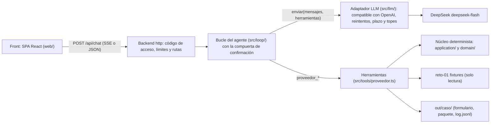

# Solución: agente "Registro como Proveedor"

Este documento responde las 10 secciones del PRD §9.1 en su orden. Cada sección es corta y enlaza el detalle en `docs/`. Para levantar el proyecto, ver el [README](README.md).

## 1. Problema en una frase

Periferia recibe de 8 a 12 solicitudes de registro como proveedor al mes, y cada una obliga a la **analista administrativa** a transcribir a mano, campo por campo, datos que ya existen en un repositorio interno (con riesgo de error en datos sensibles como la cuenta bancaria o el NIT), a buscar los soportes y a armar el correo de respuesta, lo que retrasa la facturación y depende de una sola persona.

El agente lee la solicitud, mapea cada campo contra el maestro, genera el formulario en el formato pedido y arma el paquete para firma. **Nunca inventa un dato**: cada valor sale de una herramienta tipada, lo que no existe queda `faltante` y lo dudoso queda `requiere_confirmacion`. Ninguna acción externa ocurre sin una confirmación explícita.

## 2. Arquitectura

| Pieza | Dónde vive |
|---|---|
| Prompt del sistema | [agent/prompt.md](agent/prompt.md): rol, orden de las herramientas y prohibición de afirmar valores que no salieron de una herramienta. |
| Conocimiento | `src/knowledge/`: el proceso ([registro-proveedor.md](src/knowledge/registro-proveedor.md)), las reglas de negocio como datos (`reglas.json`) y las plantillas de checklist y correo. |
| Ejecución | `src/tools/`: las cinco herramientas de `proveedor.ts`, que el modelo ve como `proveedor_<export>`, con argumentos validados por zod y respuesta `{ ok, data }` o `{ ok: false, error }`. |
| Datos | Los fixtures de `reto-01/` se leen y nunca se modifican. Todo lo generado va a `out/<caso>/`. |

El modelo solo orquesta: decide qué herramienta llamar y redacta el resumen. Las herramientas leen, deciden con reglas del dominio y escriben. Al modelo le llegan rutas y valores enmascarados, nunca los valores sensibles del maestro.

El bonus `modulo/` empaqueta esas mismas tres piezas: `agent.md` se genera desde `agent/prompt.md`, la skill desde el conocimiento, y `tools/proveedor.ts` reexporta los mismos objetos de `src/tools/proveedor.ts` (ver [modulo/README.md](modulo/README.md)).

Detalle de capas e importaciones permitidas: [docs/arquitectura.md](docs/arquitectura.md) y [docs/estructura.md](docs/estructura.md).

## 3. Ciclo del agente

El bucle está escrito a mano (`src/loop/`), sin framework, para que el tope de iteraciones, el presupuesto y la compuerta sean código propio y verificable. Cada turno emite eventos al front: `turn_start`, `tool_start`, `tool_end`, `text`, `confirmation_required`, `usage`, `error` y `turn_end`.

1. El mensaje de la analista se agrega al historial y el bucle llama al modelo con el prompt, el conocimiento y las herramientas.
2. Cada llamada de herramienta se valida con zod. Si los argumentos no son válidos, el modelo recibe `{ ok: false, error }` y puede corregir.
3. El bucle repite hasta que el modelo responde sin herramientas o hasta uno de los topes:
   - `AGENT_MAX_ITERATIONS` (25 por defecto): al alcanzarlo, el agente responde con lo que tiene y lo que falta (CA1);
   - `AGENT_SESSION_TOKEN_BUDGET` (300 000 tokens por sesión) y `AGENT_DAILY_TOKEN_BUDGET` (2 M por día y proceso);
   - `AGENT_TURN_DEADLINE_MS` (120 s por turno), `LLM_TIMEOUT_MS` por llamada y `LLM_MAX_OUTPUT_TOKENS` por respuesta.

**La compuerta de confirmación la decide el servidor, no el modelo.** Cuando `proveedor_armar_paquete` deja un caso listo para enviar, el servidor lo marca pendiente, emite `confirmation_required` y escribe él mismo la pregunta de cierre, con el caso y sus bloqueos. `proveedor_simular_envio` solo corre si el mensaje inmediatamente anterior confirmó ese caso, ya sea con la `accion` estructurada de la tarjeta de confirmación (`{ tipo: "confirmar", caso }`) o con un "sí" explícito en texto. Si el modelo intenta enviar antes, el servidor lo bloquea con `CONFIRMACION_REQUERIDA`. Además, la herramienta exige `confirmado: true`.

| Regla | Cómo se cumple |
|---|---|
| CA1 | Tope de iteraciones por turno con cierre que lista lo que falta. |
| CA2 | Los valores solo salen de herramientas, y el modelo ni siquiera ve los valores sensibles. |
| CA3 | Compuerta del servidor, pregunta escrita por el servidor y tarjeta resaltada en el front. |
| CA4 | Cada llamada aparece en el chat y en `out/log.jsonl` y `out/<caso>/log.jsonl`, con el resumen redactado. |
| CA5 | Los errores de herramienta o del proveedor (402, 429, plazo vencido) llegan al chat en español. La sesión sigue viva. |

## 4. Elección del modelo y costo por caso

**Proveedor y modelo:** DeepSeek, `deepseek-flash`, con el modo thinking desactivado y `temperature: 0`.

**Por qué:**

- lo eligió la usuaria;
- es muy barato y su caché de contexto abarata el prompt fijo desde la segunda llamada;
- usa la API de OpenAI con tool calls, así que basta un adaptador genérico;
- sin thinking, cada respuesta es más rápida y no hay que reenviar `reasoning_content`.

El modelo no está atado al código: el adaptador lee `LLM_PROVIDER`, `LLM_BASE_URL`, `LLM_MODEL` y `LLM_API_KEY`, y hay un proveedor de respaldo opcional (`LLM_FALLBACK_*`).

**Precios** por millón de tokens, de https://api-docs.deepseek.com/quick_start/pricing (consultado el 2026-10-15). DeepSeek publica qué horas son pico y cuáles valle; ni la constante de precios ni la evidencia guardan esa franja, así que la tabla de costos muestra las dos tarifas:

| Tarifa | Entrada con caché | Entrada sin caché | Salida |
|---|---|---|---|
| Pico | 0.006 | 0.30 | 1.20 |
| Valle | 0.003 | 0.15 | 0.60 |

**Costo medido** en una corrida real contra el modelo, que terminó el 2026-10-16 a las 04:54 UTC (la evidencia registra la hora del final de la corrida). Cada caso se procesó en una sesión nueva, y el guion del PRD §11 ("procesa ec-corp-andina…" y después "envía") corrió en una sesión de 2 turnos. La evidencia está en [docs/evidencia/costo-por-caso.json](docs/evidencia/costo-por-caso.json), y una prueba exige que esta tabla coincida con ella:

| Escenario | Turnos | Llamadas | Entrada | Cache hit | Cache miss | Salida | USD pico | USD valle |
|---|---|---|---|---|---|---|---|---|
| co-industrias-delta | 1 | 5 | 38788 | 36480 | 2308 | 922 | 0.0020 | 0.0010 |
| ec-corp-andina | 1 | 5 | 38322 | 35584 | 2738 | 948 | 0.0022 | 0.0011 |
| hn-agroexport-sula | 1 | 5 | 36937 | 34688 | 2249 | 800 | 0.0018 | 0.0009 |
| pa-logistica-istmo | 1 | 5 | 36194 | 34304 | 1890 | 708 | 0.0016 | 0.0008 |
| guion-11 | 2 | 7 | 57710 | 56320 | 1390 | 1082 | 0.0021 | 0.0010 |
| Total | 6 | 27 | 207951 | 197376 | 10575 | 4460 | 0.0097 | 0.0049 |

Un caso procesado cuesta unos **0.002 USD en tarifa pico y 0.001 USD en valle**. Con 8 a 12 solicitudes al mes, el costo mensual queda por debajo de 0.03 USD. Es una muestra única, no un promedio: el modelo puede tomar otro camino de herramientas en otra corrida. Más del 90 % de la entrada fue cache hit, porque el prefijo del prompt es estable.

Para reproducirla: `bun run costo`, con la clave en `.env`. Reescribe la evidencia y la prueba vuelve a comparar la tabla.

## 5. Diseño del portal web

Hoy el formato portal no se automatiza (PRD HU-3 P2). Para `pa-logistica-istmo`, `proveedor_generar_formulario` responde `ok: true` con el aviso "formato no soportado" y escribe `out/<caso>/valores-portal.md` con cada etiqueta y su valor listos para copiar. El paquete y la confirmación siguen igual.

**Estrategias evaluadas:**

| Opción | A favor | En contra |
|---|---|---|
| Navegador controlado por el agente (Playwright en un worker aislado) | Llena todo solo. | Choca con CAPTCHA y MFA, se rompe con cada cambio de layout, y el agente tendría que manejar la sesión del portal. |
| RPA de escritorio | Herramienta conocida en back office. | Licencias caras y scripts frágiles por portal. |
| **Extensión de navegador en la sesión de la analista (elegida)** | La analista entra al portal con su propio navegador. La extensión lee los valores aprobados del caso y llena los campos que reconoce. | Hay que mantener un mapa de selectores por portal. |

**Límites y cómo se manejan:**

- **CAPTCHA:** nunca se intenta resolver ni evadir. Lo resuelve la persona.
- **MFA:** lo completa la persona en su dispositivo.
- **Cambios de layout:** el mapa de selectores se versiona por portal. Si un campo no se encuentra, la extensión no adivina: lo marca y vuelve al modo copiar y pegar de `valores-portal.md`.

**Credenciales:** viven en el gestor de secretos o de contraseñas de la empresa, a nombre de la analista o de un usuario de servicio por cliente. Nunca van en el repositorio, en el prompt, en el conocimiento ni en los logs. La analista las ingresa ella misma, y el agente nunca las ve ni las recibe como argumento.

**Quién hace qué:**

- **El agente** prepara los valores, los estados (`lleno`, `faltante`, `requiere_confirmacion`), el paquete y el checklist.
- **La persona** ingresa las credenciales, resuelve CAPTCHA y MFA, revisa cada campo prellenado y hace clic en **Enviar**.

El agente nunca hace clic en Enviar ni en ningún botón que comprometa a la empresa.

## 6. Decisiones y trade-offs

- **El LLM solo orquesta un núcleo determinista (D-09).** Leer, mapear, generar y armar son funciones puras con pruebas golden. El modelo decide el orden y redacta.
  Alternativa descartada: dejar que el modelo lea los JSON y llene los valores. Es más corto de escribir, pero no se puede probar y es justo el riesgo del PRD §10 (el modelo "completa" un faltante).
- **Bucle propio en lugar de un framework de agentes.** Servicios cortos en `src/loop/` dejan a la vista el tope, el presupuesto, el plazo y la compuerta, que es lo que evalúan CA1 a CA5.
  Alternativa descartada: LangChain o el AI SDK de Vercel, porque esconden el bucle y el adaptador, y suman dependencias que habría que justificar.
- **La compuerta la decide el servidor.** El modelo no puede confirmar por su cuenta: el servidor guarda el caso pendiente, escribe la pregunta y bloquea el envío sin confirmación.
  Alternativa descartada: confiar en que el prompt haga preguntar al modelo. Un modelo que se salta la instrucción enviaría.
- **Minimizar la PII hacia el modelo.** El modelo ve rutas del maestro y valores enmascarados. Las herramientas escriben los valores reales en `out/`.
  Alternativa descartada: pasarle el maestro completo. Sería más simple, pero expone datos bancarios a un tercero sin necesidad.
- **SSE sobre un `POST`, con respaldo JSON.** El chat muestra en vivo cada tool call y la tarjeta de confirmación.
  Alternativa descartada: WebSockets, un canal bidireccional que no hace falta y que complica proxies y pruebas.
- **Cookie de acceso firmada, `HttpOnly`, con `SameSite` y `Secure` fuera de desarrollo.** Se emite tras `POST /api/acceso` con el código, y la SPA nunca guarda el código ni un token legible por JavaScript.
  Alternativa descartada: guardar el código o un token en `localStorage` y mandarlo como `Bearer`, que queda expuesto a cualquier XSS. `Bearer` se mantiene solo para clientes de línea de comandos.
- **Render free con Dockerfile como plan B.** Es gratis, tiene secretos en el panel y despliega desde `main` solo si pasa la CI.
  Alternativa descartada: un VPS propio, porque cuesta y suma operación. El mismo `Dockerfile` sirve para migrar a Fly, Koyeb u otro proveedor.

**Dependencias** (PRD §8). Bun ya trae el runner de pruebas, la lectura de `.env`, TypeScript nativo y el `fetch`, así que no se usan dotenv, jest, ts-node, axios ni uuid.

| Paquete | Versión | Tipo | Para qué |
|---|---|---|---|
| `zod` | 4.6.5 | producción | Obligatorio por el PRD. Valida los argumentos de las herramientas, el entorno, el cuerpo de la API y las respuestas del modelo. `z.toJSONSchema` genera el esquema que ve el modelo. |
| `hono` | 4.13.13 | producción | Rutas, middlewares, `streamSSE` con cancelación, cookies firmadas y estáticos sobre `Bun.serve`, sin dependencias propias. |
| `exceljs` | 4.4.0 | producción | Escribe `formulario.xlsx` en la hoja y la celda exactas. Puede leer plantillas reales del cliente conservando estilos. |
| `pdf-lib` | 1.17.1 | producción | Genera `formulario.pdf` sin navegador ni binarios. Falla con un error claro ante caracteres que no puede codificar. |
| `pino` | 10.3.1 | producción | Logs JSON a stdout con ids de correlación. La redacción propia se aplica antes de escribir. |
| `react` | 19.3.0 | desarrollo | La SPA del chat. Se compila antes y el servidor solo sirve los archivos estáticos. |
| `react-dom` | 19.3.0 | desarrollo | Render de la SPA en el navegador. |
| `vite` | 8.3.3 | desarrollo | Servidor de desarrollo con proxy a la API y build de la SPA con `bun --bun`. |
| `@vitejs/plugin-react` | 6.1.2 | desarrollo | JSX y recarga en caliente para Vite. |
| `eventsource-parser` | 4.1.1 | desarrollo | Lee el SSE de un `fetch` con `POST` en la SPA y en el pre-flight, porque `EventSource` no permite cuerpo ni cabeceras. |
| `typescript` | 7.0.2 | desarrollo | `tsc --noEmit` del backend y de la web, en modo estricto y sin `any`. |
| `@biomejs/biome` | 2.5.15 | desarrollo | Lint y formato en un solo binario, sin depender de la API de TypeScript. |
| `@types/bun` | 1.4.2 | desarrollo | Tipos de `Bun.*` y de `bun:test`. |
| `@types/react` | 19.3.0 | desarrollo | Tipos de React. |
| `@types/react-dom` | 19.3.0 | desarrollo | Tipos de React DOM. |
| `@testing-library/react` | 16.3.3 | desarrollo | Monta los componentes y la `App` real en las pruebas DOM y los consulta por rol y nombre accesible, como los usa una persona. |
| `@testing-library/dom` | 10.4.2 | desarrollo | Par obligatorio de `@testing-library/react` 16, que ya no lo trae incluido. Se fija explícito para que la versión no cambie sola. |
| `@testing-library/user-event` | 14.6.7 | desarrollo | Simula secuencias reales de teclado y clic: Enter contra Shift+Enter en el compositor y las flechas en las pestañas. |
| `happy-dom` | 20.14.6 | desarrollo | DOM en JavaScript puro para `bun test`, sin navegador. Trae `matchMedia`, `showModal` y `ResizeObserver`, que usa la SPA. |
| `@happy-dom/global-registrator` | 20.14.6 | desarrollo | Registra happy-dom por archivo de prueba DOM y lo quita al terminar, así las pruebas del backend siguen con el `fetch` nativo. |

Los cinco paquetes de pruebas DOM son solo de desarrollo: la etapa de producción del `Dockerfile` instala con `--production`, así que ninguno llega a la imagen. Se fijaron versiones con al menos 7 días publicadas, sin scripts de instalación y con `bun audit` limpio.

El `overrides` de `uuid` (`^11.1.1`) cierra un aviso moderado de una dependencia transitiva de `exceljs`. `bun audit` corre en un job aparte de la CI que no bloquea el badge.

## 7. Supuestos

- **Fecha de ejecución.** Las vigencias se calculan contra `FECHA_EJECUCION`. La demo, las pruebas y Render la fijan en `2026-09-03`, la fecha de los fixtures, para que el resultado sea el mismo en la defensa que en las pruebas. Es configurable, y si queda vacía se usa la fecha de hoy en `TZ_NEGOCIO`.
- **Envío con bloqueos.** Se puede "enviar" un paquete con bloqueos (soportes vencidos o ausentes) si la analista lo confirma explícitamente. `ENVIO-SIMULADO.md` registra los bloqueos con que salió. El agente informa, y la decisión es humana.
- **Rúbrica.** El PRD §10 no trae la tabla de puntos de la rúbrica, así que cada "debe", "obligatorio" o "evaluamos" del PRD se trató como un ítem a cumplir.
- **Portal.** Responder `ok: true` con el aviso "formato no soportado" y los valores para copiar cumple HU-3 P2 sin cortar el paquete.
- **Correo.** `borrador-correo.md` es una respuesta a `solicitud.de` y nunca incluye datos bancarios (RN2) ni afirma que el formulario esté firmado.
- **`demo.ts` sin modelo (D-70).** Verifica el núcleo llamando directo a las herramientas, sin clave. La conducta con el modelo se verifica con un LLM falso en las pruebas y con las corridas en vivo opcionales (`bun run test:vivo`).
- **Ids canónicos (WR-03).** La consola de la demo, el `resumen` de las herramientas y `log.jsonl` usan los ids de máquina de cada soporte, que son el contrato v1. Los nombres en español solo aparecen en las salidas para personas.
- **Nombres de soporte (IN-01).** `checklist.md`, `borrador-correo.md` y `ENVIO-SIMULADO.md` nombran cada soporte con `NOMBRE_SOPORTE` de `src/config/strings.ts`, que es la fuente que manda. No se usa la `descripcion` del índice de soportes porque describe un archivo concreto (por ejemplo, con el año). Si un tipo nuevo no está en la tabla, la salida muestra el id crudo para que el soporte no desaparezca. Por eso, al agregar un tipo hay que agregar su nombre, y `tests/golden/nombres-soporte.test.ts` lo exige para los tipos de los fixtures.
- **Datos ficticios.** Solo se usan los fixtures del reto, y ningún documento ni log de este repositorio trae datos reales.

## 8. Cobertura por historia de usuario

| Historia | Estado | Qué falta para producción |
|---|---|---|
| HU-1 · Leer la solicitud | hecho | Leer el correo real y sus adjuntos (hoy llegan normalizados como JSON) y tolerar plantillas peores que las de los fixtures. |
| HU-2 · Mapear campos al maestro | hecho | Un dueño del maestro que lo mantenga al día y un glosario que crezca con los clientes. |
| HU-3 · Generar el formulario | hecho | Llenar la plantilla real del cliente (hoy el xlsx se escribe en celdas exactas y el PDF se genera, como acepta el PRD) y automatizar portales con el diseño de la §5. |
| HU-4 · Armar el paquete para firma | hecho | Envío real por correo y firma electrónica, ambos con confirmación humana. |
| HU-5 · Manejo de errores | hecho | Alertas operativas y métricas de errores por cliente. |
| Bonus `modulo/` (PRD §9.4) | parcial | Ensayarlo en vivo dentro de OpenCode. El formato se verificó contra la documentación, pero no se ejecutó en una sesión real (D-83). |
| Diseño del portal (PRD §7.4) | hecho | Construir la extensión de la §5. Hoy es solo diseño, como pide el PRD. |

## 9. Uso de IA

**Asistente:** Claude Code (modelos Claude de Anthropic), usado con el flujo **GSD** (Get Shit Done), que divide el trabajo en fases: discutir, investigar, planear, ejecutar, verificar, revisar el código y auditar la seguridad. Cada fase deja su contexto, sus planes y sus resúmenes en `.planning/`, con las decisiones numeradas (D-01 en adelante) y tomadas por la usuaria en cada discusión.

**Para qué tareas:**

- investigar versiones, APIs y límites (Bun, DeepSeek, Render, OpenCode);
- planear cada fase con sus criterios de aceptación;
- escribir el código y las pruebas, con TDD en la lógica de negocio;
- revisar el código y auditar las amenazas;
- QA en el navegador con Playwright;
- redactar esta documentación, que la usuaria revisa antes de entregar.

**Wrappers propios.** Se construyeron dos para adaptar GSD a este repositorio:

- `eli-qa-sdd-gsd` envuelve la verificación de GSD con suites de QA reproducibles (`.qa/suites/`). Propone recetas por prueba de aceptación (CLI, llamada directa a herramientas, lectura de xlsx, pdf y md, logs, escaneo de PII, determinismo, HTTP, SSE y navegador con Playwright), las corre con una autorización y muestra la evidencia. El veredicto siempre lo da la persona.
- `eli-qa-map-repos` mapea las superficies ejecutables del repositorio en `.qa/qa-topology.json` (comandos, puertos, logs y nombres de variables, sin secretos), para que el runner nunca adivine cómo levantar algo.

**Cómo se orientó el flujo hacia la calidad:**

- **Guardianes de arquitectura:** G1–G16 en `tests/architecture.test.ts` y W1–W13 en `tests/arquitectura-web.test.ts`. Cada regla de capas, nombres, idioma y textos tiene una prueba que demuestra que detecta la violación.
- **Prueba sin comentarios:** `tests/sin-comentarios.test.ts` exige código que se explique por sus nombres y tipos.
- **Revisión de código por fase:** cada hallazgo (CR, WR, IN) se corrigió o quedó aceptado por escrito.
- **Auditoría de seguridad:** modelo de amenazas en cada plan. La Fase 3 cerró 87/87 amenazas verificadas contra el código.
- **UAT con evidencia** en `.qa/evidence/`, y ciclos de cierre de brechas cuando una verificación o una UAT encontraba un hueco.

[docs/convenciones.md](docs/convenciones.md) resume las reglas.

**Qué se descartó de lo propuesto y por qué:**

- **LangChain y el AI SDK de Vercel.** Esconden el bucle, el tope y el adaptador, que es justo lo que pide el PRD.
- **El SDK `openai`.** Sus tipos no traen los campos propios de DeepSeek (`thinking`, `reasoning_content`) y obligaban a hacer casts. Se usó `fetch` con tipos y reintentos propios.
- **SheetJS.** Se distribuye desde su CDN fuera de npm, la versión de npm tiene avisos de seguridad y la edición comunitaria pierde los estilos. Se eligió `exceljs`.
- **Tailwind.** Es mucha configuración para una sola pantalla. Se usó CSS plano con variables de diseño.
- **`react-markdown`.** Suma una dependencia y una superficie de XSS. Los mensajes se muestran como texto con `white-space: pre-wrap`.
- **La gramática de rechazo por texto.** Tres planes seguidos (02-22 a 02-24) la ajustaron, y cada arreglo abría una regresión en el sentido contrario. La usuaria cortó el ciclo con la regla de primera palabra (D-63.11), y el botón estructurado de la tarjeta (D-39) evita depender del texto.
- **El ciclo de parches del limitador de acceso.** Cada parche destapaba un caso adversarial más rebuscado. Se revirtió el último (71d8d20) y se aceptó el tope por IP aproximado, documentado en [docs/limites-del-demo.md](docs/limites-del-demo.md).

## 10. Riesgos y mitigaciones

**Estado en memoria y disco efímero.** El demo corre en una sola instancia de Render free. Al reiniciar, al redesplegar o cuando Render duerme el servicio tras 15 minutos sin tráfico, se pierde lo siguiente:

- el tope diario de tokens (D-73.6), que vuelve a cero;
- los limitadores por IP (intentos de acceso, mensajes por minuto y sesiones nuevas por hora);
- los cupos de turnos simultáneos;
- las sesiones con su presupuesto;
- los archivos de `out/`.

La SPA detecta la sesión o el archivo perdidos y ofrece reprocesar.

Se acepta en el reto por cuatro motivos: es una sola instancia gratuita, la clave es personal y prepaga (al agotarse, la API responde 402 y el chat lo dice), la ventana de la defensa es corta y el link está detrás de un código de acceso. Los topes que no dependen del proceso siguen en pie: las iteraciones por turno, el presupuesto por sesión, el `max_tokens` por llamada y el plazo por turno.

**Qué haría un despliegue real:**

- Redis o una base de datos para contadores, bloqueos y sesiones, con claves que vencen solas;
- reservar tokens antes de cada llamada para que la concurrencia no pase el tope diario;
- límites y alertas de gasto en la clave del proveedor, con una clave de servicio en lugar de una personal;
- una instancia paga siempre activa, o varias instancias con estado compartido;
- almacenamiento de objetos persistente para `out/`, con URLs firmadas y vencimiento;
- `out/` separado por sesión o por usuario, por ejemplo `out/<sesión>/<caso>/`, o un prefijo por sesión en el almacenamiento de objetos, para que una sesión nunca liste los archivos de otra.

El detalle, incluidos el tope por IP aproximado, el recibo por reserva y el plazo de lectura del cuerpo de `/api/acceso` que quedaron como trabajo futuro, está en [docs/limites-del-demo.md](docs/limites-del-demo.md).

**Riesgos del PRD §10:**

- **El modelo "completa" un faltante.** Las herramientas son la única fuente de valores, el modelo no ve los valores sensibles y el prompt prohíbe afirmar valores.
- **CAPTCHA o MFA en portales.** Los opera la persona (§5).
- **Maestro desactualizado.** Hace falta un dueño del dato. Si el maestro cambia después de armar el paquete, `proveedor_simular_envio` rechaza con `PAQUETE_DESACTUALIZADO` y el agente vuelve a armar y a pedir confirmación.

**Riesgos aceptados y conocidos:**

- **AR-02-06 (D-63.11).** Con un caso pendiente, un pedido que lo nombra y no empieza con un verbo de pedido tras una respuesta de espera (por ejemplo, "No, por favor consulta el NIT de ec-corp-andina") cancela el caso. Va al lado seguro: nunca envía, y el "sí" siguiente no envía. El botón de la tarjeta evita el caso.
- **T-02-41.** Sobre la pregunta del servidor pueden quedar líneas del modelo que no son pregunta. La compuerta solo autoriza el caso pendiente, y el último párrafo siempre es la pregunta del servidor con el caso y sus bloqueos.
- **SEG-02.** En `.planning/REQUIREMENTS.md` figura como parcial. El código actual aplica una única `redactar()` (`src/domain/policies/redaccion.policy.ts`) a los logs, a los resúmenes de tool calls, a la respuesta JSON de `/api/chat` y a cada evento SSE, y hay escaneos de PII en las pruebas. Falta cerrarlo formalmente con una verificación que actualice la trazabilidad.
- **D-80 y el módulo.** Fuera del servidor (OpenCode) nadie escribe la pregunta de confirmación. La red de seguridad es la skill, que exige una confirmación explícita, y la herramienta, que rechaza sin `confirmado: true`. El módulo no se ensayó en vivo en OpenCode (D-83). Como trabajo futuro queda un paquete distribuible construido con `bun build`.
- **`out/<caso>/` compartido entre sesiones.** El PRD fija las salidas en `out/<caso>/`, así que todas las sesiones que procesan el mismo caso leen y escriben la misma carpeta, y `out/<caso>/log.jsonl` junta las llamadas de todas. Una sesión nueva puede ver en el panel de casos el paquete y el `ENVIO-SIMULADO.md` que dejó otra sesión, hasta que su turno 1 los reconstruye. No se envía nada, porque la compuerta solo pide confirmación por un paquete armado en la misma sesión. Se acepta en el reto (una analista, una instancia, y cambiarlo es conducta de la API y de la SPA), y en la defensa el pre-flight con `--guion` y los ensayos se corren la víspera.
- **Seguimientos menores de la QA de la Fase 3:**
  - el panel puede listar un archivo ya borrado hasta recibir el 404;
  - un campo en pausa no se atenúa;
  - los 401 y 429 no dejan una línea de log;
  - a 375×667, el control para seguir el final de la conversación queda como una sola flecha de 40 px;
  - mientras un caso está pendiente, su tarjeta sigue visible entre turnos. Cancelar en la tarjeta quita solo ese caso (D-69), pero un rechazo por texto cancela todos los pendientes (AR-02-06).
- **Operación de la defensa.** Render duerme y tarda cerca de un minuto en despertar, así que se corre `bun run preflight` unos 10 minutos antes. El modo `--guion` se corre la víspera y no justo antes de la defensa. La clave es prepaga, así que se revisa el saldo. El código de acceso se rota después de la evaluación.
