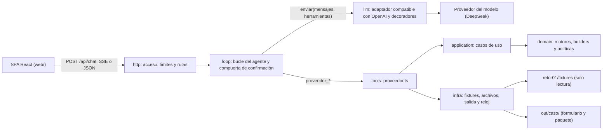
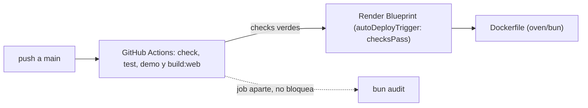

# Arquitectura

Este documento sirve para retomar el proyecto: explica cómo viaja un pedido, qué capa hace qué y hacia dónde pueden apuntar las importaciones. El detalle por módulo vive en [estructura.md](estructura.md), las reglas y sus guardianes en [convenciones.md](convenciones.md), y lo que se pierde al reiniciar el servicio en [limites-del-demo.md](limites-del-demo.md).

## Propósito

Un agente conversacional llena los formularios de registro como proveedor de Periferia IT Group. La analista escribe en un chat web ("procesa el caso X"). El agente lee la solicitud, mapea cada campo contra el repositorio maestro, genera el formulario (xlsx, pdf o valores para portal), arma el paquete para firma y pide una confirmación explícita antes de cualquier envío simulado. El agente nunca inventa un dato: cada valor sale de una herramienta tipada que lo lee del maestro.

## Recorrido de un pedido

1. La SPA manda `{ sessionId, message }` a `POST /api/chat` con la cookie de acceso. Por defecto recibe eventos SSE; con `Accept: application/json` recibe la forma de referencia del PRD §6.4.
2. La capa `http` valida el cuerpo, aplica el código de acceso y los límites por IP, y le pasa el turno al bucle.
3. El bucle (`loop`) conversa con el modelo a través del puerto neutral `AdaptadorLlm`, despacha cada llamada de herramienta con zod y corta en el tope de iteraciones, el presupuesto de tokens o el plazo del turno.
4. Las herramientas leen la solicitud y el maestro, deciden con las reglas del dominio y escriben en `out/<caso>/`. Al modelo solo le llegan valores enmascarados.
5. La compuerta de confirmación la decide el servidor: `proveedor_simular_envio` solo corre después de una confirmación explícita de la analista, y la herramienta además exige `confirmado: true`.

## Dónde vive cada cosa

| Pieza | Dónde | Qué contiene |
|---|---|---|
| Prompt del sistema | `agent/prompt.md` | El rol del agente, el orden de las herramientas y la prohibición de inventar valores. |
| Conocimiento | `src/knowledge/` | `registro-proveedor.md` (el proceso), `reglas.json` (reglas de negocio) y `plantillas/` (ver [plantillas.md](plantillas.md)). |
| Ejecución | `src/tools/` | Las cinco herramientas de `src/tools/proveedor.ts`, que el modelo ve como `proveedor_<export>`. |
| Datos de entrada | `reto-01/fixtures/` | Los casos y el maestro del reto. Nunca se modifican. |
| Salida | `out/<caso>/` | El formulario, el paquete para firma y `ENVIO-SIMULADO.md`. Es disco efímero en Render. |

## Capas y direcciones permitidas

Las dependencias apuntan hacia adentro: dominio puro, después herramientas y casos de uso, después infraestructura y al final HTTP. El guardián de `tests/architecture.test.ts` declara esta tabla y tiene una prueba de violación por regla.

| Capa | Carpeta | Puede importar |
|---|---|---|
| Dominio | `src/domain/` | Dominio y config pura. |
| Aplicación | `src/application/` | Dominio, aplicación y config pura. |
| Config | `src/config/` | La config pura (`constants/`, `types/`, `strings.ts`) no importa nada de afuera y cualquiera la importa. `config/env.ts` es el único lector del entorno. |
| Conocimiento | `src/knowledge/` | Es contenido (markdown y JSON), no código. Lo lee infra. |
| Herramientas | `src/tools/` | Dominio, aplicación, config, zod y sus propios módulos. Solo `tools/wiring/entorno.wiring.ts` importa infra. |
| Infraestructura | `src/infra/` | Dominio, aplicación, config, `node:`, zod, exceljs, pdf-lib y pino. |
| Modelo | `src/llm/` | Solo la config pura y zod. |
| Bucle | `src/loop/` | `llm`, dominio, aplicación, los tipos de las herramientas, la config pura y zod. Solo `loop/wiring/agente.wiring.ts` importa infra y `config/env.ts`. |
| HTTP | `src/http/` | `http`, `loop`, `llm`, dominio, aplicación, la config pura, zod y hono. Solo `http/wiring/server.wiring.ts` importa infra, `config/env.ts`, el wiring del agente y `node:`. |
| CLI | `src/cli/` | `cli`, dominio, config, zod, `node:`, `eventsource-parser` y, con `import type`, los tipos de `http`. |
| Demo | `src/demo/` | La herramienta exportada, config y `node:`. |

Hay tres composition roots, los únicos que importan infra: `src/tools/wiring/entorno.wiring.ts`, `src/loop/wiring/agente.wiring.ts` y `src/http/wiring/server.wiring.ts`. `src/server.ts` es la entrada del proceso: solo importa el wiring del servidor y `node:`, y no lee el entorno. Ninguna capa interior importa `http`.

## Comandos de línea (`src/cli/`)

- `bun run modulo` regenera `modulo/agent.md` y `modulo/skill/registro-proveedor/SKILL.md` a partir de los bytes exactos de `agent/prompt.md` y del conocimiento.
- `bun run preflight` es un cliente de caja negra del link público: despierta el servicio, comprueba `/api/health` y el código de acceso, y con `--guion` corre el §11 completo.

## Módulo reutilizable (`modulo/` y `.opencode/`)

`modulo/` es la única fuente del agente empaquetado: `agent.md`, la skill y `tools/proveedor.ts`, que reexporta los mismos objetos de `src/tools/proveedor.ts`. `.opencode/` solo enlaza `modulo/` para que OpenCode cargue las herramientas, y `opencode.json` registra el agente y la skill. Los detalles y límites están en [modulo/README.md](../modulo/README.md).

## Front (`web/`)

`web/` es una SPA de Vite y React organizada por features: cada componente vive en `web/src/features/<feature>/<componente>/` (o en `web/src/compartido/` si lo usan varias), con su vista, su hook `usar-<componente>.ts` y su módulo CSS. El estado vive en un almacén propio, `web/src/store/`, sobre `useSyncExternalStore`, que combina los reductores puros de cada `features/<feature>/estado/` y expone selectores con nombre. Las vistas solo presentan; los hooks leen el almacén y hablan con la API por `fetch`, y el SSE se lee con `eventsource-parser`. Los mensajes del servidor se muestran como texto, nunca como HTML, y el front nunca decide un estado de negocio: presenta lo que recibe. Tiene su propio guardián en `tests/arquitectura-web.test.ts`, con las reglas W de la tabla de [convenciones.md](convenciones.md).

## De la CI a Render

Render despliega solo si pasan los checks de la CI. El `Dockerfile` es también el plan B portable a otro proveedor. El servicio gratuito se duerme tras 15 minutos sin tráfico y su disco es efímero: ver [limites-del-demo.md](limites-del-demo.md).

## Cómo retomar

1. Leer el `README.md` de la raíz para levantar el proyecto y [convenciones.md](convenciones.md) antes de tocar código.
2. Correr `bun install`, `bun run check` y `bun test`. Deben quedar verdes antes y después de cada cambio.
3. El plan y la historia del trabajo viven en `.planning/` (flujo GSD): `PROJECT.md` (decisiones clave), `ROADMAP.md`, `STATE.md`, `MILESTONES.md` y, en `.planning/milestones/v1-phases/`, una carpeta por fase con su contexto, sus planes y sus resúmenes. El roadmap, los requisitos y la auditoría del milestone v1 están archivados en `.planning/milestones/`.
4. Las suites reproducibles de QA de eli-qa viven en `.qa/suites/`, con la evidencia en `.qa/evidence/`.
5. Las decisiones del reto se justifican en `SOLUCION.md` (trade-offs, supuestos, riesgos y uso de IA).
